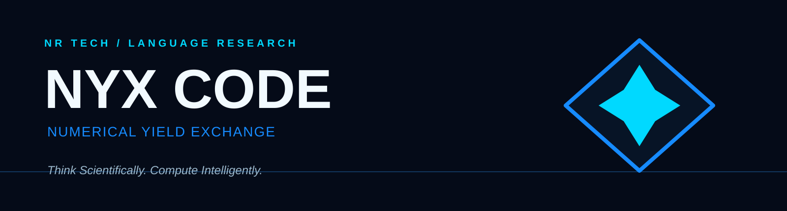
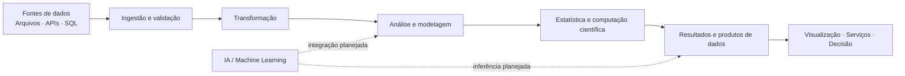
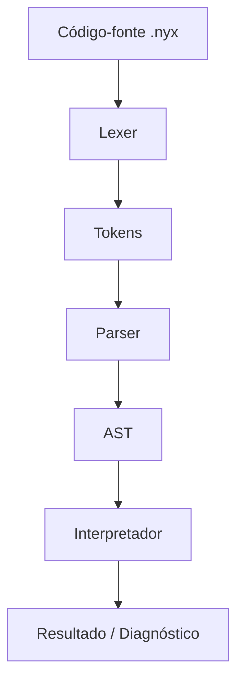
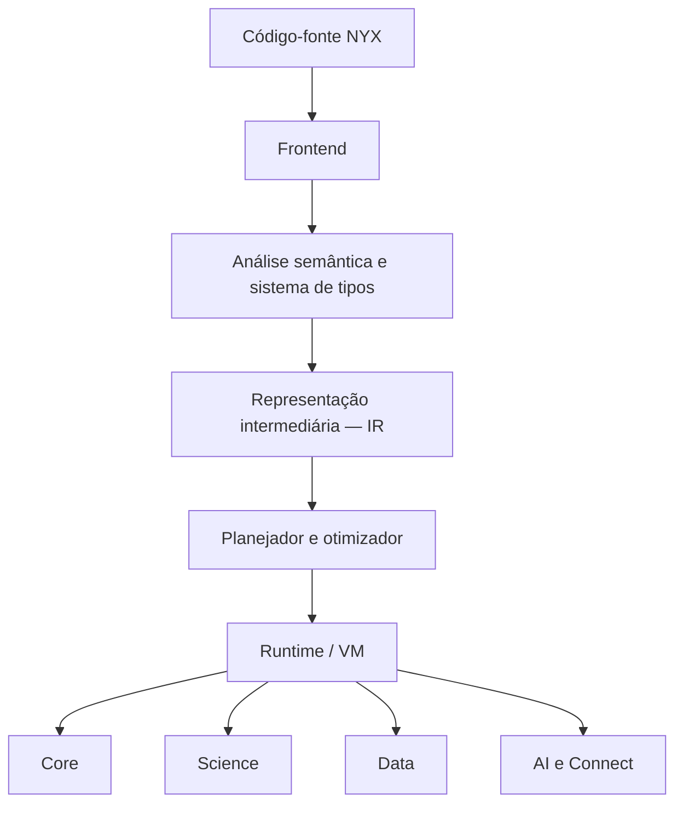

<!--
  NYX — Numerical Yield eXchange
  Identidade: NR TECH | azul profundo + ciano
  Princípio: capacidades implementadas são separadas explicitamente da visão futura.
-->

<div align="center">
  
  <br />
  
  <h1>NYX — Numerical Yield eXchange</h1>
  <p><strong>Uma linguagem independente em construção para ciência, dados e computação.</strong></p>
  <p><em>Think Scientifically. Compute Intelligently.</em></p>
  <p>
    
    
    
    
  </p>
  <p>
    <a href="#visão-geral">Visão geral</a> ·
    <a href="#identidade-e-princípios">Identidade</a> ·
    <a href="#o-que-a-nyx-já-faz">Implementação</a> ·
    <a href="#ciência-de-dados-e-computação">Ciência e dados</a> ·
    <a href="#arquitetura">Arquitetura</a> ·
    <a href="#instalação-e-execução">Instalação</a> ·
    <a href="#roadmap">Roadmap</a>
  </p>
</div>

---

## Visão geral

A NYX é um projeto autoral da NR TECH que busca construir uma linguagem de programação com identidade, sintaxe, semântica e arquitetura próprias. Seu horizonte de aplicação reúne computação científica, ciência de dados, engenharia de dados, automação, modelagem matemática e interoperabilidade com ecossistemas computacionais.

A proposta não é apenas criar mais uma interface para bibliotecas existentes. É estabelecer uma base linguística e computacional coerente, na qual estruturas de dados, operações numéricas, execução e integração possam evoluir sob contratos explícitos.

> [!IMPORTANT]
> Estado real do projeto: alfa. A especificação 0.6 e o código da linha de desenvolvimento já contemplam variáveis, expressões, controle de fluxo, funções e listas nativas. A linguagem ainda não possui compilador nativo, sistema de tipos estático, estruturas tabulares, bibliotecas científicas próprias, paralelismo ou recursos nativos de IA. Esses elementos pertencem à visão e ao roadmap — não devem ser confundidos com funcionalidades entregues.

## Identidade e princípios

O nome NYX expressa três eixos que orientam o projeto:

| Elemento | Conceito | Diretriz |
|---|---|---|
| **N — Numerical** | Fundamento matemático e computacional | Representar, transformar e calcular com rigor |
| **Y — Yield** | Produção de resultados e conhecimento | Converter processamento em resultados verificáveis |
| **X — eXchange** | Integração e interoperabilidade | Conectar linguagens, dados, serviços e infraestruturas |

### Princípios fundamentais

1. **Independência semântica:** a linguagem define suas próprias regras; a tecnologia hospedeira não determina sua gramática.
2. **Rigor científico:** operações numéricas devem ter semântica documentada, precisão conhecida e validação.
3. **Dados como domínio central:** estruturas, transformações e fluxos de dados são parte importante da evolução da linguagem.
4. **Interoperabilidade explícita:** integrações com bancos, APIs, arquivos, bibliotecas e serviços devem ocorrer por interfaces delimitadas.
5. **IA desacoplada:** inteligência artificial será uma camada de integração opcional, não uma dependência para interpretar ou executar programas NYX.
6. **Desempenho demonstrável:** otimizações e paralelismo deverão ser sustentados por benchmarks reproduzíveis.
7. **Evolução verificável:** cada capacidade só será considerada entregue quando houver implementação, testes, documentação e critérios de aceitação.

## O que a NYX já faz

<sub>Escopo da implementação na branch de desenvolvimento, correspondente à especificação 0.6.</sub>

| Componente | Capacidade | Estado |
|---|---|---|
| Análise léxica | Lexer próprio, tokens e localização de erros | Implementado |
| Análise sintática | Parser recursivo descendente | Implementado |
| Representação sintática | AST própria | Implementado |
| Valores fundamentais | Integer, Float, String, Boolean e Null | Implementado |
| Variáveis | Declaração com `let` e atribuição | Implementado |
| Expressões | Operações aritméticas, relacionais e lógicas | Implementado |
| Controle de fluxo | `if`, `else` e `while` | Implementado |
| Funções | `fn`, parâmetros, chamadas, retorno e recursividade | Implementado |
| Coleções | Listas heterogêneas, aninhadas e mutáveis | Implementado |
| Indexação | Leitura, indexação aninhada e atribuição por índice | Implementado |
| Funções nativas | `len()` e `append()` | Implementado |
| Execução | Interpretador tree-walk e CLI | Implementado |
| Diagnósticos | Erros com linha e coluna | Implementado |
| Compatibilidade de fonte | UTF-8 com e sem BOM; separação por quebra de linha | Implementado |

### Exemplo: funções, listas e fluxo de execução

```nyx
fn calcular_media(valores) {
    let total = 0
    let indice = 0

    while (indice < len(valores)) {
        total = total + valores[indice]
        indice = indice + 1
    }

    return total / len(valores)
}

let leituras = [21.5, 22.0, 23.4, 24.1]
let media = calcular_media(leituras)

append(leituras, 25.0)

print(media)
print(len(leituras))
print(leituras[4])
```

O exemplo demonstra recursos efetivamente presentes no núcleo atual: declaração e atribuição, função com parâmetro, retorno, repetição, indexação, listas e funções nativas.

### Exemplos no repositório

| Arquivo | Conteúdo |
|---|---|
| [00_primeiro_programa.nyx](examples/00_primeiro_programa.nyx) | Sintaxe elementar e expressões |
| [01_controle_de_fluxo.nyx](examples/01_controle_de_fluxo.nyx) | Condicionais, repetição e atribuição |
| [02_colecoes.nyx](examples/02_colecoes.nyx) | Listas, indexação, mutabilidade e aliases |

## Ciência de dados e computação

A ciência de dados é um dos domínios estratégicos da NYX. A intenção é aproximar, em uma linguagem coerente, etapas que frequentemente aparecem distribuídas entre ferramentas, bibliotecas e ambientes diferentes.

### Domínios de aplicação pretendidos

| Domínio | Escopo conceitual | Exemplos de capacidades futuras |
|---|---|---|
| **NYX Core** | Fundamentos da linguagem e execução | Tipos, módulos, coleções, erros e runtime |
| **NYX Science** | Computação matemática e científica | Álgebra linear, estatística, probabilidade, vetores, matrizes e tensores |
| **NYX Data** | Engenharia e análise de dados | Tabelas, leitura de arquivos, filtros, joins, agregações e transformações |
| **NYX AI** | Integração com inteligência artificial | Interfaces de modelos, inferência, pipelines de ML e integração com provedores |
| **NYX Connect** | Interoperabilidade | SQL, bancos de dados, APIs, formatos de arquivos e bibliotecas externas |
| **NYX Runtime** | Execução e desempenho | Representação intermediária, planejamento, otimização e paralelismo |

Esses nomes representam domínios arquiteturais planejados. Não significam que tais módulos já estejam disponíveis no protótipo.

### Fluxo conceitual de um ciclo de dados



### Quadro comparativo: ecossistema atual e proposta NYX

A comparação abaixo é de posicionamento arquitetural, não de desempenho. Python, R, SQL e plataformas distribuídas são ecossistemas maduros; a NYX ainda é um projeto alfa.

| Critério | Linguagens generalistas | Ecossistemas científicos e de dados | Direção arquitetural da NYX |
|---|---|---|---|
| Propósito | Amplo, multiparadigma | Análise, estatística ou processamento especializado | Linguagem independente orientada a ciência, dados e computação |
| Semântica | Definida por cada linguagem | Distribuída entre linguagem e bibliotecas | Semântica própria e especificada |
| Matemática científica | Bibliotecas e extensões | Forte especialização em ferramentas consolidadas | Domínio nativo planejado; ainda não implementado |
| Engenharia de dados | Bibliotecas, frameworks e conectores | Ecossistemas de pipelines e processamento | Domínio de dados planejado |
| Inteligência artificial | Integração por bibliotecas e serviços | Ferramentas especializadas de ML/IA | Camada desacoplada e interoperável planejada |
| Interoperabilidade | Varia conforme o ecossistema | Geralmente ampla por conectores | Princípio arquitetural explícito |
| Compilação e otimização | Depende da linguagem e do runtime | Depende da plataforma | IR, otimização e runtime próprio no horizonte |
| Maturidade | Ecossistemas estabelecidos | Ecossistemas estabelecidos | Alfa — desenvolvimento inicial |

### Onde a NYX pretende chegar

- Computação numérica com semântica previsível.
- Estruturas científicas, vetoriais e matriciais.
- Operações tabulares e pipelines de dados.
- Integração com bancos relacionais, arquivos e APIs.
- Interoperabilidade com ferramentas e bibliotecas externas.
- Integração com modelos de machine learning e IA.
- Execução otimizada, paralelismo e reprodutibilidade.

A ambição é construir uma plataforma coerente, não prometer que uma linguagem recém-criada já substitui ferramentas especializadas.

## Arquitetura

A implementação atual utiliza um interpretador de caminhada pela AST (*tree-walk*). A arquitetura de longo prazo prevê uma separação progressiva entre frontend, análise, representação intermediária e execução.

### Pipeline atual



### Arquitetura evolutiva



O segundo diagrama representa a direção arquitetural desejada, não a arquitetura já entregue. A especificação da linguagem deve permanecer independente da tecnologia utilizada para implementar o runtime. Python é a tecnologia hospedeira do protótipo atual; Rust é uma possibilidade de infraestrutura futura, não uma dependência presente.

Documentação técnica:
- [Especificação da linguagem](docs/ESPECIFICACAO_INICIAL.md)
- [Arquitetura](docs/ARQUITETURA.md)
- [Roadmap](docs/ROADMAP.md)

## Instalação e execução

### Requisitos

- Python 3.10 ou superior.
- Git para clonar o repositório.

### Instalar a versão de desenvolvimento

A branch de desenvolvimento contém a evolução documentada na especificação 0.6. Para experimentar esse código, instale diretamente do repositório:

```bash
git clone https://github.com/nrdataanalysis-1908/NYX-CODE.git
cd NYX-CODE

python -m venv .venv
```

Windows PowerShell:

```powershell
.\.venv\Scripts\Activate.ps1
python -m pip install -e ".[dev]"
```

Linux / macOS:

```bash
source .venv/bin/activate
python -m pip install -e ".[dev]"
```

### Executar os exemplos

```bash
nyx run examples/00_primeiro_programa.nyx
nyx run examples/01_controle_de_fluxo.nyx
nyx run examples/02_colecoes.nyx
```

Alternativamente:

```bash
python -m nyx run examples/02_colecoes.nyx
```

### Executar os testes

```bash
python -m pytest -q
```

### Pacote PyPI

O nome de distribuição registrado é `nrtech-nyx`. A versão publicada `0.1.0a1` é uma prévia inicial e não deve ser confundida com todo o conjunto de recursos da linha de desenvolvimento 0.6.

```bash
python -m pip install nrtech-nyx
```

Para testar funções, controle de fluxo e coleções descritos neste README, prefira a instalação a partir do código-fonte da branch de desenvolvimento.

## Roadmap

| Etapa | Objetivo | Direção |
|---|---|---|
| 01 | Fundação da linguagem | Consolidar gramática, semântica e testes de conformidade |
| 02 | Sistema de tipos | Análise semântica, inferência e regras explícitas |
| 03 | Ciência computacional | Vetores, matrizes, estatística e operações numéricas |
| 04 | Engenharia de dados | Estruturas tabulares, formatos, transformações e conectores |
| 05 | Runtime e desempenho | IR, planejamento, otimização e benchmarks |
| 06 | Execução avançada | Concorrência, paralelismo e gestão de recursos |
| 07 | Inteligência artificial | Interfaces de ML, inferência e integrações desacopladas |
| 08 | Ecossistema | Documentação, ferramentas, pacotes e interoperabilidade |

A conclusão de cada etapa depende de código funcional, testes automatizados, documentação em português e instruções reproduzíveis. Consulte o [roadmap detalhado](docs/ROADMAP.md).

## Qualidade e validação

A linha de desenvolvimento possui testes automatizados e integração contínua configurada para múltiplas versões do Python. A validação deve abranger, além dos casos positivos, entradas inválidas, limites, escopos, tipos, mutabilidade e diagnósticos.

Desempenho não será presumido: qualquer alegação de otimização deverá vir acompanhada de benchmark reproduzível, ambiente documentado e comparação equivalente.

## Contribuição

A NYX está em estágio alfa e sua evolução exige rigor na preservação da semântica.

1. Consulte a especificação antes de propor mudanças na linguagem.
2. Abra uma discussão ou issue descrevendo problema, motivação e comportamento esperado.
3. Inclua testes para novos recursos e regressões.
4. Atualize a documentação e os exemplos.
5. Não apresente capacidades planejadas como funcionalidades concluídas.

## Licença

Distribuído sob a licença Apache License 2.0. Consulte o arquivo [LICENSE](LICENSE).

---

<div align="center">
  
  <p><strong>NYX · NR TECH</strong></p>
  <p><em>Think Scientifically. Compute Intelligently.</em></p>
  <sub>Uma linguagem em construção. Uma arquitetura guiada por rigor, interoperabilidade e evolução verificável.</sub>
</div>
