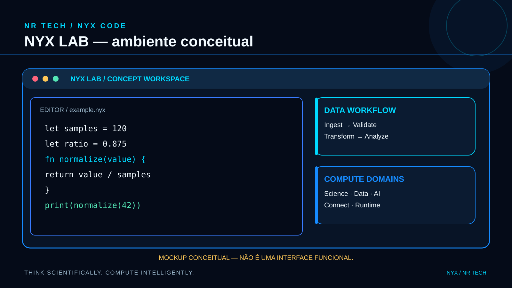
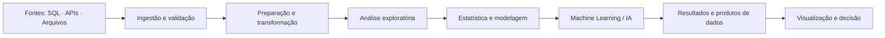
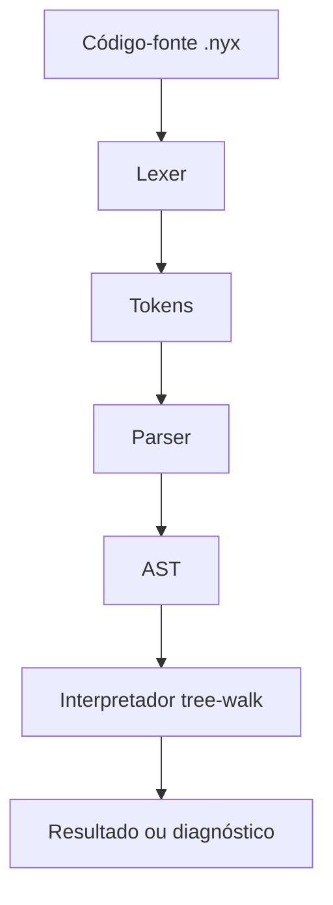
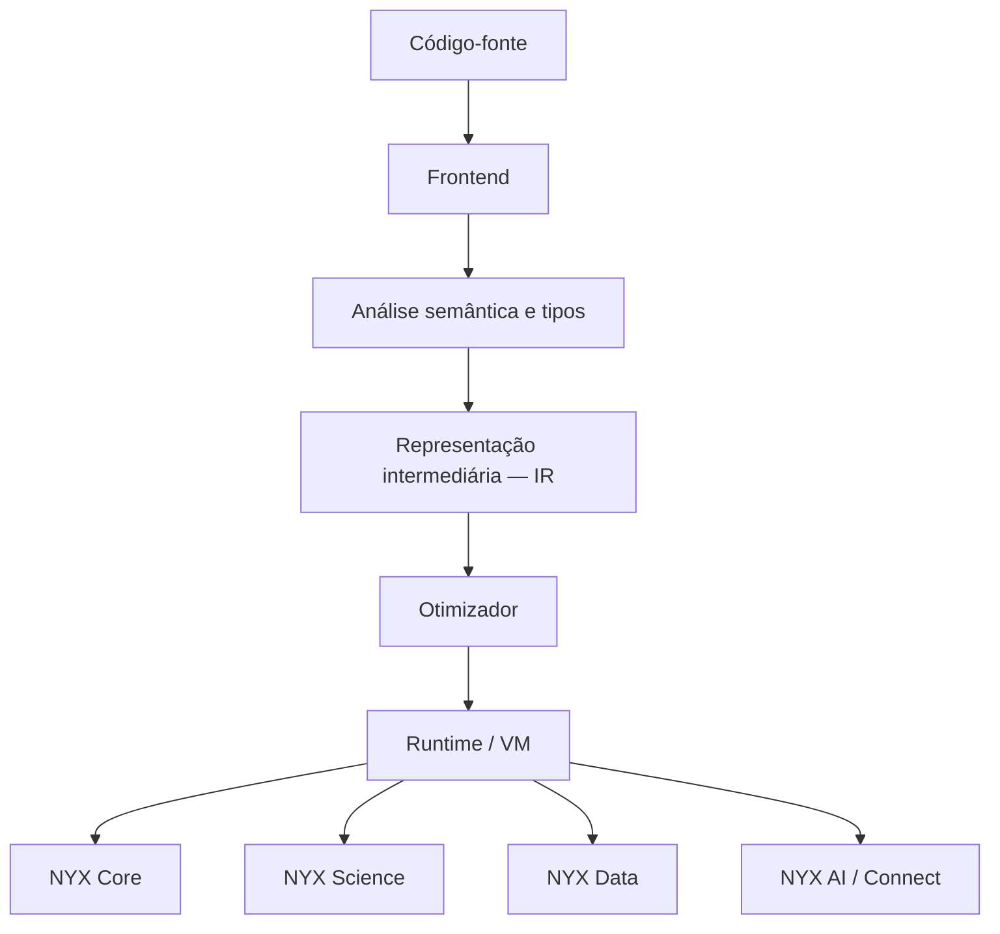
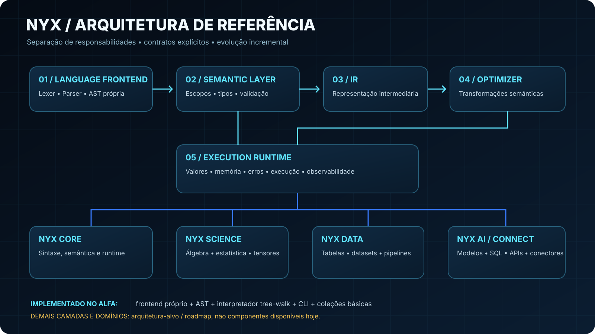
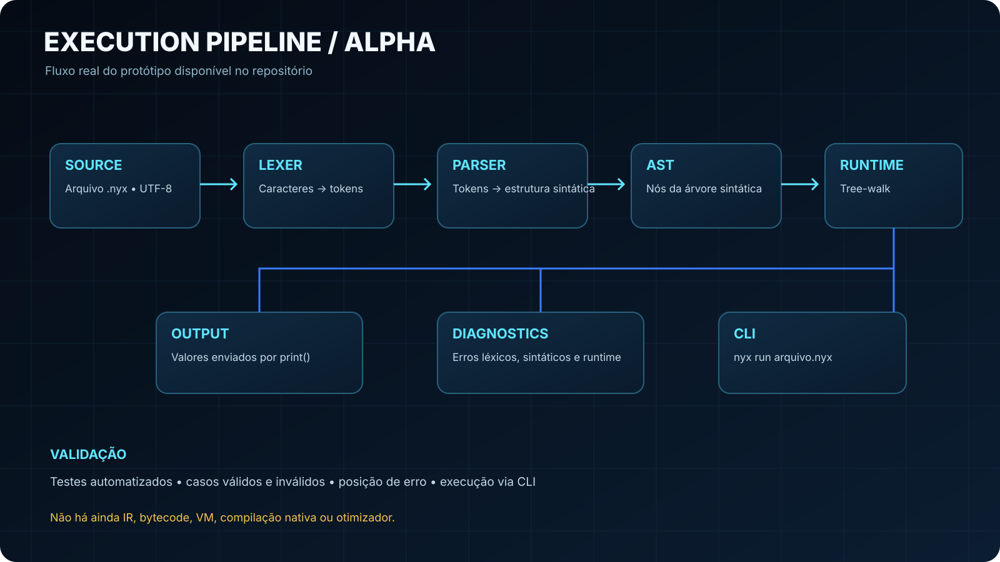
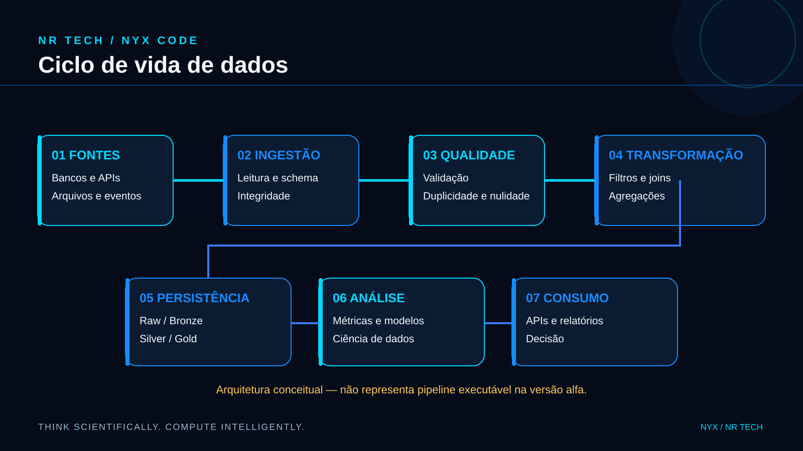
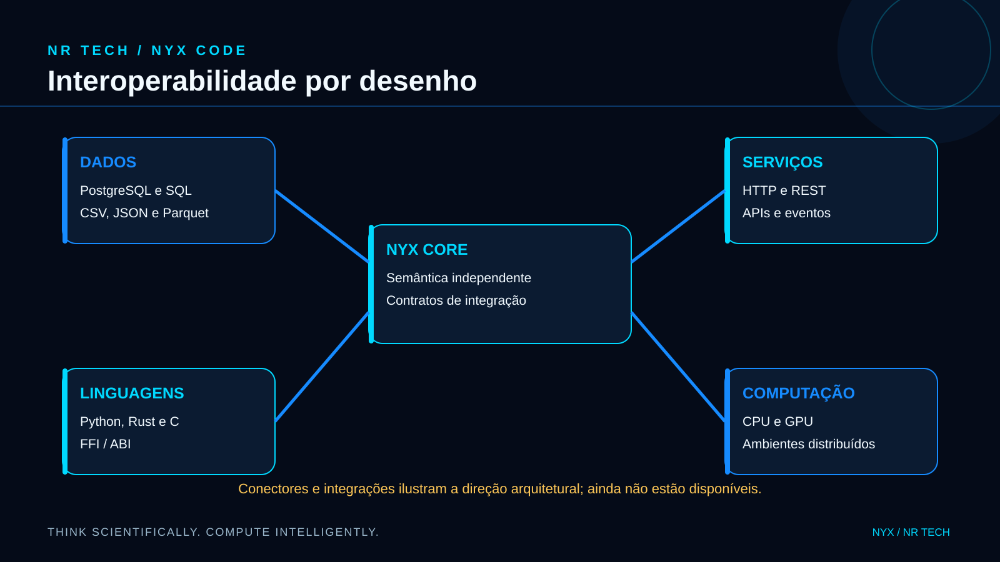
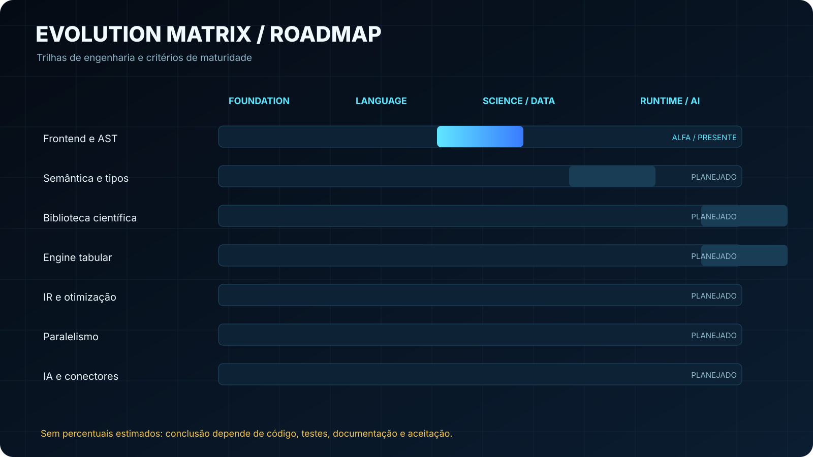

<div align="center">


# NYX CODE

### NR TECH | LINGUAGEM DE PROGRAMAÇÃO PARA CIÊNCIA, DADOS E COMPUTAÇÃO

Uma linguagem independente em construção, com sintaxe, semântica e arquitetura próprias.

**Think Scientifically. Compute Intelligently.**


[Documentação](docs/ESPECIFICACAO_INICIAL.md) · [Arquitetura](docs/ARQUITETURA.md) · [Roadmap](docs/ROADMAP.md) · [Releases](https://github.com/nrdataanalysis-1908/NYX-CODE/releases)

</div>

<p align="center">
  
</p>

---

## 01. Visão do projeto

A NYX é um projeto autoral da NR TECH que busca desenvolver uma linguagem de programação independente, orientada à computação científica, ciência de dados, engenharia de dados, automação e interoperabilidade.

A proposta é construir uma base computacional coerente: linguagem própria, regras semânticas explícitas, estruturas de dados, execução verificável e integração com diferentes ecossistemas.

A NYX não pretende ser apenas uma camada sintática sobre Python. Python hospeda o protótipo atual, mas não define a identidade, a gramática ou a semântica da linguagem.

> [!IMPORTANT]
> Estado real: alfa, especificação 0.6 na branch de desenvolvimento. O núcleo já possui lexer, parser, AST, interpretador, variáveis, expressões, controle de fluxo, funções e listas. Compilador nativo, sistema de tipos estático, matrizes, tabelas, bibliotecas científicas, paralelismo e módulos de IA ainda não estão implementados.

## 02. Identidade: Numerical · Yield · eXchange

| Símbolo | Significado | Princípio |
|:---:|---|---|
| **N** | **Numerical** | Fundamento matemático, numérico e computacional |
| **Y** | **Yield** | Produção de resultados, conhecimento e valor verificável |
| **X** | **eXchange** | Interoperabilidade entre linguagens, dados, serviços e infraestruturas |

### Diretrizes fundamentais

- **Independência semântica:** a NYX define suas próprias regras e evolução.
- **Rigor científico:** precisão, comportamento numérico e limitações documentados.
- **Dados como domínio central:** estruturas e transformações de dados como eixo de evolução.
- **Interoperabilidade:** integração por interfaces, contratos e conectores explícitos.
- **IA desacoplada:** modelos de IA serão integráveis, mas não necessários para interpretar ou executar código NYX.
- **Desempenho mensurável:** otimizações sustentadas por benchmarks reproduzíveis.
- **Evolução verificável:** nenhuma capacidade é considerada pronta sem implementação, testes e documentação.

## 03. Núcleo implementado

Recursos existentes na linha de desenvolvimento correspondente à especificação 0.6:

| Camada | Recursos | Situação |
|---|---|---|
| Frontend | Lexer, tokens, parser e AST próprios | Implementado |
| Tipos fundamentais | Integer, Float, String, Boolean e Null | Implementado |
| Estado | Declaração `let`, atribuição e escopos | Implementado |
| Expressões | Aritmética, comparação e lógica | Implementado |
| Controle | `if`, `else` e `while` | Implementado |
| Funções | `fn`, parâmetros, chamadas, retorno e recursão | Implementado |
| Coleções | Listas heterogêneas, aninhadas e mutáveis | Implementado |
| Indexação | Leitura, indexação aninhada e atribuição por índice | Implementado |
| Built-ins | `len()` e `append()` | Implementado |
| Execução | Interpretador tree-walk e CLI | Implementado |
| Diagnóstico | Erros com linha e coluna | Implementado |

### Exemplo de código NYX

```nyx
fn calcular_media(valores) {
    let total = 0
    let indice = 0

    while (indice < len(valores)) {
        total = total + valores[indice]
        indice = indice + 1
    }

    return total / len(valores)
}

let leituras = [21.5, 22.0, 23.4, 24.1]
let resultado = calcular_media(leituras)

print(resultado)
```

O exemplo utiliza apenas recursos já implementados no núcleo atual.

### Exemplos disponíveis

| Arquivo | Demonstração |
|---|---|
| [00_primeiro_programa.nyx](examples/00_primeiro_programa.nyx) | Sintaxe e expressões |
| [01_controle_de_fluxo.nyx](examples/01_controle_de_fluxo.nyx) | Condicionais, laços e atribuição |
| [02_colecoes.nyx](examples/02_colecoes.nyx) | Listas, indexação e mutabilidade |

## 04. Ciência de dados e domínios computacionais

A NYX nasce com uma orientação multidisciplinar. O objetivo de longo prazo é oferecer uma linguagem capaz de transitar entre fundamentos matemáticos, processamento de dados, análise, modelagem e integração de sistemas.

| Domínio planejado | Escopo | Capacidades pretendidas |
|---|---|---|
| **NYX Core** | Linguagem e execução | Tipos, módulos, runtime, memória e semântica |
| **NYX Science** | Computação científica | Álgebra linear, estatística, probabilidade, matrizes e tensores |
| **NYX Data** | Engenharia e ciência de dados | Dados tabulares, ingestão, filtros, joins, agregações e pipelines |
| **NYX AI** | Inteligência artificial | Machine learning, inferência e integração com modelos |
| **NYX Connect** | Interoperabilidade | SQL, APIs, bancos, arquivos e bibliotecas externas |
| **NYX Runtime** | Desempenho | IR, otimização, concorrência e execução paralela |

> Os domínios acima representam a arquitetura pretendida. Não são módulos disponíveis na versão alfa atual.

### Ciclo de ciência de dados — visão conceitual



### Quadro comparativo de posicionamento

A tabela compara paradigmas e posicionamento, não desempenho. Python, R, SQL e plataformas distribuídas são ecossistemas maduros; NYX ainda está em estágio alfa.

| Critério | Linguagens generalistas | Ecossistemas científicos e de dados | Direção da NYX |
|---|---|---|---|
| Finalidade | Uso amplo e multiparadigma | Análise e processamento especializados | Ciência, dados e computação em uma linguagem independente |
| Semântica | Definida pela linguagem | Linguagem, bibliotecas e plataformas | Semântica própria e especificada |
| Computação científica | Bibliotecas e extensões | Ferramentas científicas consolidadas | Recursos científicos planejados |
| Engenharia de dados | Bibliotecas e frameworks | Pipelines e motores especializados | Domínio de dados planejado |
| IA e ML | Bibliotecas e serviços | Ecossistemas especializados | Camada de IA desacoplada planejada |
| Interoperabilidade | Varia por ecossistema | Conectores e APIs | Princípio arquitetural explícito |
| Runtime | Varia por linguagem | Varia por plataforma | Runtime próprio no horizonte |
| Maturidade | Ecossistemas estabelecidos | Ecossistemas estabelecidos | Alfa — núcleo inicial |

## 05. Arquitetura

### Pipeline de execução atual



### Evolução arquitetural pretendida



O primeiro diagrama representa a implementação atual. O segundo expressa uma direção de arquitetura futura. A linguagem deve permanecer independente da tecnologia hospedeira. Python é utilizado no protótipo; uma infraestrutura em Rust é uma possibilidade futura, não uma dependência atual.

## 06. Instalação e execução

### Requisitos

- Python 3.10 ou superior.
- Git.

### Obter o código-fonte

```powershell
git clone https://github.com/nrdataanalysis-1908/NYX-CODE.git
cd NYX-CODE

python -m venv .venv
.\.venv\Scripts\Activate.ps1
python -m pip install -e ".[dev]"
```

### Executar um programa

```powershell
nyx run examples/02_colecoes.nyx
```

Alternativa:

```powershell
python -m nyx run examples/02_colecoes.nyx
```

### Executar os testes

```powershell
python -m pytest -q
```

### Distribuição PyPI

O pacote registrado é [nrtech-nyx](https://pypi.org/project/nrtech-nyx/). A versão publicada 0.1.0a1 é uma prévia anterior e não corresponde a todos os recursos da especificação 0.6.

```powershell
python -m pip install nrtech-nyx
```

Para experimentar as funcionalidades descritas na especificação 0.6, utilize a instalação a partir do código-fonte da branch de desenvolvimento.

## 07. Roadmap

| Etapa | Frente | Objetivo |
|:---:|---|---|
| 01 | Fundação | Gramática, semântica e testes de conformidade |
| 02 | Sistema de tipos | Tipagem, análise semântica e inferência |
| 03 | NYX Science | Vetores, matrizes, estatística e operações numéricas |
| 04 | NYX Data | Estruturas tabulares, arquivos e pipelines |
| 05 | Runtime | IR, otimização e benchmarks |
| 06 | Execução avançada | Concorrência, paralelismo e gestão de memória |
| 07 | NYX AI | Interfaces de ML, inferência e integrações |
| 08 | Ecossistema | Módulos, pacotes, documentação e ferramentas |

Cada etapa deverá ser acompanhada por implementação funcional, testes automatizados, documentação e critérios de aceitação.

## 08. Qualidade e validação

A linha de desenvolvimento possui testes automatizados e integração contínua para múltiplas versões do Python. A validação deve contemplar casos positivos, entradas inválidas, limites, escopos, tipos, mutabilidade e diagnósticos.

Alegações de desempenho dependerão de benchmarks reproduzíveis, ambiente documentado e comparação equivalente.

## 09. Estrutura do projeto

```text
NYX-CODE/
├── src/nyx/              # Lexer, parser, AST, interpretador e CLI
├── tests/                # Testes automatizados
├── examples/             # Programas de demonstração
├── docs/                 # Especificação, arquitetura e roadmap
├── assets/               # Identidade visual NYX
├── .github/workflows/    # CI e publicação
├── pyproject.toml
└── README.md
```

## 10. Contribuição

A NYX está em estágio alfa. Contribuições devem preservar a coerência da linguagem:

1. Consulte a especificação antes de propor mudanças sintáticas ou semânticas.
2. Descreva motivação, comportamento esperado e impacto.
3. Inclua testes para funcionalidades e regressões.
4. Atualize documentação e exemplos.
5. Diferencie claramente capacidades implementadas de propostas futuras.

## 11. Licença

Distribuído sob a licença Apache License 2.0. Consulte o arquivo [LICENSE](LICENSE).

---

<div align="center">


### NYX · NR TECH

**Think Scientifically. Compute Intelligently.**

Uma linguagem em construção. Uma arquitetura guiada por rigor, interoperabilidade e evolução verificável.

</div>


## 22. Visão sistêmica: da linguagem ao produto de dados

A ambição da NYX exige que a linguagem seja pensada como um sistema de componentes cooperantes. O código-fonte é apenas a primeira interface. Ao longo da evolução, a plataforma deverá definir como programas são analisados, como valores são representados, como dados são movimentados, como operações são executadas e como resultados podem ser auditados.

<p align="center"></p>

### Componentes e fronteiras

| Componente | Entrada | Saída | Contrato que deverá preservar |
|---|---|---|---|
| Frontend | Código-fonte | Tokens e AST | Gramática e localização |
| Semântica | AST e ambiente | Programa validado | Regras de nomes e tipos |
| IR | Programa validado | Grafo ou sequência intermediária | Equivalência semântica |
| Planejador | IR e contexto | Plano de execução | Determinismo e custo explícito |
| Runtime | Plano e valores | Resultado ou erro | Semântica operacional |
| Bibliotecas | Valores e estruturas | Operações especializadas | Tipos e invariantes |
| Conectores | Solicitações e credenciais | Dados externos | Segurança e contratos |
| Observabilidade | Eventos de execução | Logs e métricas | Rastreabilidade e privacidade |

### Separação entre linguagem, biblioteca e infraestrutura

Essa separação evita que uma decisão de implementação se torne uma regra implícita da linguagem. Uma operação científica, por exemplo, deverá possuir semântica definida independentemente do backend numérico escolhido. Da mesma forma, um conector SQL não deve alterar o comportamento de atribuição, escopo ou tipos do núcleo.

## 23. Modelo de execução: presente e evolução

<p align="center"></p>

### Implementação disponível

O protótipo atual percorre a AST por meio de um interpretador tree-walk. Isso favorece a validação inicial da gramática e da semântica, reduzindo o número de componentes necessários para experimentar a linguagem.

### Limitações desse modelo

- A avaliação depende diretamente da estrutura da AST.
- Não existe representação intermediária independente.
- Não existe bytecode ou máquina virtual.
- Não existe compilação para código nativo.
- Não há otimizador de planos ou instruções.
- Não há gerenciamento próprio de memória.
- Não há paralelismo de execução implementado.

### Caminho técnico possível

1. Formalizar os contratos semânticos do núcleo.
2. Separar a análise semântica da avaliação.
3. Definir uma representação intermediária estável.
4. Implementar validação e transformação da IR.
5. Criar um backend de execução controlado.
6. Medir custo de interpretação e de execução.
7. Avaliar VM, bytecode ou compilação nativa conforme evidência técnica.

A sequência é uma direção de engenharia. Não implica que exista uma migração em andamento ou que um backend específico já tenha sido escolhido.

## 24. Infraestrutura de dados: arquitetura de referência

<p align="center"></p>

### Contratos de dados

Uma futura infraestrutura de dados deverá explicitar, no mínimo:

| Contrato | Perguntas que precisam de resposta |
|---|---|
| Schema | Quais campos, tipos, nulabilidade e restrições existem? |
| Identidade | Como registros e entidades são identificados? |
| Qualidade | Quais regras determinam validade e rejeição? |
| Proveniência | De qual fonte e transformação veio cada resultado? |
| Evolução | Como mudanças de schema serão detectadas e tratadas? |
| Particionamento | Como os dados serão distribuídos e consultados? |
| Ordenação | Quando a ordem é garantida e quando não é? |
| Consistência | Quais garantias existem entre leitura e escrita? |
| Erros | Como linhas inválidas e falhas de fonte serão representadas? |
| Segurança | Como credenciais, permissões e dados sensíveis serão protegidos? |

### Operações candidatas para NYX Data

As operações abaixo representam uma taxonomia de domínio para orientar a especificação. Não são funções disponíveis na versão alfa.

| Grupo | Operações candidatas |
|---|---|
| Ingestão | read, scan, stream, validate |
| Seleção | select, project, filter |
| Combinação | join, union, concat |
| Agregação | group_by, aggregate, window |
| Qualidade | is_null, deduplicate, assert_schema |
| Organização | sort, partition, repartition |
| Persistência | write, checkpoint, snapshot |
| Proveniência | lineage, source, transformation_metadata |

### Plano lógico e plano físico

Uma engine analítica madura normalmente precisa distinguir a intenção declarativa da forma concreta de execução. A NYX deverá avaliar essa separação quando houver uma camada tabular real.

- Plano lógico: descreve o resultado solicitado.
- Otimizador: avalia transformações equivalentes.
- Plano físico: escolhe algoritmos e recursos de execução.
- Runtime: executa o plano e reporta métricas.
- Camada de armazenamento: controla leitura, escrita e formatos.

Essa arquitetura só deverá ser adotada após a definição da semântica de tabelas, tipos, nulidade e operações relacionais.

## 25. Infraestrutura científica: precisão, estabilidade e reprodutibilidade

Computação científica não se resume à disponibilidade de funções matemáticas. A linguagem deverá documentar o comportamento numérico, inclusive seus limites.

### Precisão numérica

Pontos a especificar antes de uma biblioteca científica estável:

- formatos numéricos e largura de representação;
- arredondamento e conversões;
- overflow e underflow;
- valores não finitos;
- comparação com tolerância;
- propagação de erros numéricos;
- estabilidade de algoritmos;
- comportamento de operações vetorizadas.

### Estatística e inferência

Uma biblioteca estatística futura deverá documentar hipóteses, estimadores, parâmetros, tratamento de ausências e interpretação dos resultados. A existência de uma função com nome estatístico não basta para garantir validade metodológica.

### Reprodutibilidade experimental

A infraestrutura poderá evoluir para registrar:
- identificador e versão do dataset;
- versão da linguagem e das bibliotecas;
- parâmetros e sementes;
- ambiente e dependências;
- transformações aplicadas;
- métricas de avaliação;
- artefatos e resultados;
- limitações e incertezas.

## 26. Interoperabilidade: adaptadores e fronteiras técnicas

<p align="center"></p>

Interoperabilidade não deve significar acoplamento irrestrito. Cada integração deverá possuir uma fronteira explícita.

### Banco de dados

A integração futura com bancos deverá considerar:
- drivers e pools de conexão;
- parâmetros e consultas preparadas;
- transações e isolamento;
- mapeamento de tipos;
- paginação e streaming;
- cancelamento e timeout;
- gestão de credenciais;
- observabilidade e auditoria.

### APIs e serviços

A camada de serviços deverá considerar:
- autenticação e autorização;
- serialização e validação de payloads;
- retry com limites;
- timeout e circuit breaker;
- idempotência;
- rate limiting;
- tratamento de indisponibilidade;
- proteção de segredos.

### Formatos de dados

A avaliação de formatos deverá levar em conta:
- leitura incremental;
- compressão;
- schema e evolução;
- tipos aninhados;
- compatibilidade entre versões;
- metadados e particionamento;
- custo de conversão e materialização.

### Integração com outras linguagens

Interfaces com Python, Rust ou C podem ser úteis para ecossistemas existentes, mas precisam respeitar ownership, ciclo de vida de memória, conversões e custos de chamada. A linguagem não deverá depender de uma única tecnologia de extensão.

## 27. Observabilidade, diagnóstico e operação

Uma linguagem voltada a aplicações analíticas precisa tornar o comportamento operacional inteligível. A observabilidade deverá crescer junto com o runtime, e não ser adicionada apenas quando surgirem problemas de produção.

| Pilar | Aplicação futura |
|---|---|
| Logs | Eventos estruturados e erros contextualizados |
| Métricas | Duração, volume, uso de memória e contadores |
| Tracing | Relação entre etapas de execução e integrações |
| Profiling | Identificação de gargalos |
| Lineage | Origem e transformação de dados |
| Diagnósticos | Arquivo, linha, coluna e contexto |
| Auditoria | Registro de operações sensíveis |
| Alertas | Condições operacionais e limites |

### Diagnóstico atual

A versão alfa já fornece localização para erros léxicos, sintáticos e de execução. Isso constitui uma base inicial, mas não deve ser confundido com tracing distribuído, profiling ou observabilidade de pipelines.

## 28. Segurança e cadeia de suprimentos

A segurança deverá ser tratada como requisito de arquitetura, especialmente quando a linguagem evoluir para conectores, execução de código externo e integração com modelos.

Princípios de projeto:

1. Não armazenar credenciais em código ou repositório.
2. Validar entradas externas e limites de recursos.
3. Isolar dependências opcionais.
4. Fixar e revisar versões de dependências em ambientes de release.
5. Registrar a origem dos artefatos distribuídos.
6. Evitar execução implícita de código externo.
7. Definir permissões mínimas para conectores.
8. Tratar logs como dados potencialmente sensíveis.
9. Documentar riscos de execução e de desserialização.
10. Incluir revisão de segurança em mudanças de runtime.

Esses princípios são diretrizes futuras; não constituem uma certificação de segurança do protótipo atual.

## 29. Estratégia de desempenho e benchmarking

A NYX não fará alegações de desempenho sem evidência reproduzível. O benchmark deverá comparar tarefas equivalentes, com entradas, ambiente e critérios publicados.

### Dimensões de medição

| Dimensão | O que medir |
|---|---|
| Latência | Tempo por execução |
| Throughput | Operações ou registros por unidade de tempo |
| Memória | Pico e perfil de alocação |
| Escalabilidade | Comportamento com aumento de volume |
| Inicialização | Tempo até a primeira execução |
| Interoperabilidade | Custo de conversão e transferência |
| Concorrência | Ganho real e contenção |
| Correção | Equivalência dos resultados |

### Protocolo de benchmark proposto

- definir workload e dataset;
- documentar hardware e sistema operacional;
- registrar versões e parâmetros;
- executar aquecimento quando aplicável;
- realizar múltiplas repetições;
- reportar mediana e dispersão;
- separar tempo de inicialização e execução;
- publicar código e instruções;
- validar equivalência dos resultados.

Não há números de benchmark publicados neste README. O protocolo acima é uma proposta metodológica para futuras comparações.

## 30. Matriz de maturidade e evolução

<p align="center"></p>

| Frente | Estado atual | Próximo marco técnico |
|---|---|---|
| Frontend | Implementado | Ampliar conformidade e diagnósticos |
| Runtime tree-walk | Implementado | Formalizar semântica e limites |
| Sistema de tipos | Em especificação | Definir regras e testes normativos |
| Módulos | Planejado | Definir resolução e visibilidade |
| Science | Planejado | Especificar operações numéricas |
| Data | Planejado | Definir schema e semântica tabular |
| IR | Planejado | Definir representação e invariantes |
| Otimização | Planejado | Benchmarks e equivalência |
| Paralelismo | Planejado | Modelo de concorrência |
| AI | Planejado | Interfaces independentes de provedor |
| Connect | Planejado | Contratos e adaptadores |

### Critério de maturidade

A evolução não será medida por quantidade de nomes de módulos ou por diagramas. Será medida por capacidades implementadas, contratos definidos, testes, documentação, compatibilidade e uso verificável.

---

## Apêndice A — Glossário técnico

| Termo | Definição no contexto do projeto |
|---|---|
| AST | Árvore sintática abstrata que representa a estrutura do programa |
| Lexer | Componente que converte caracteres em tokens |
| Parser | Componente que reconhece a gramática |
| Runtime | Infraestrutura responsável pela execução |
| Tree-walk | Estratégia de avaliação que percorre a AST |
| IR | Representação intermediária entre frontend e backend |
| Backend | Componente que executa ou traduz uma representação |
| Data lineage | Rastreabilidade da origem e das transformações dos dados |
| Schema | Estrutura e contrato dos dados |
| Lazy evaluation | Avaliação adiada até a necessidade do resultado |
| Eager evaluation | Avaliação imediata da operação |
| FFI | Interface para interoperar com código de outra linguagem |
| ABI | Contrato binário entre componentes compilados |
| Throughput | Quantidade de trabalho processada por unidade de tempo |
| Profiling | Análise do custo e comportamento da execução |
| Reprodutibilidade | Capacidade de repetir um procedimento sob condições registradas |

## Apêndice B — Documentos normativos e de apoio

- [Especificação 0.6](docs/ESPECIFICACAO_INICIAL.md): comportamento documentado do núcleo alfa.
- [Especificação formal em elaboração](docs/ESPECIFICACAO_LINGUAGEM.md): gramática e decisões semânticas preliminares.
- [Arquitetura](docs/ARQUITETURA.md): responsabilidades e evolução dos componentes.
- [Roadmap](docs/ROADMAP.md): fases e critérios de conclusão.
- [Exemplos científicos](docs/EXEMPLOS_CIENTIFICOS.md): propostas de sintaxe e domínios.

---

<div align="center">


### NYX · NR TECH

**Think Scientifically. Compute Intelligently.**

Linguagem independente. Ciência aplicada. Engenharia orientada por evidências.

</div>
