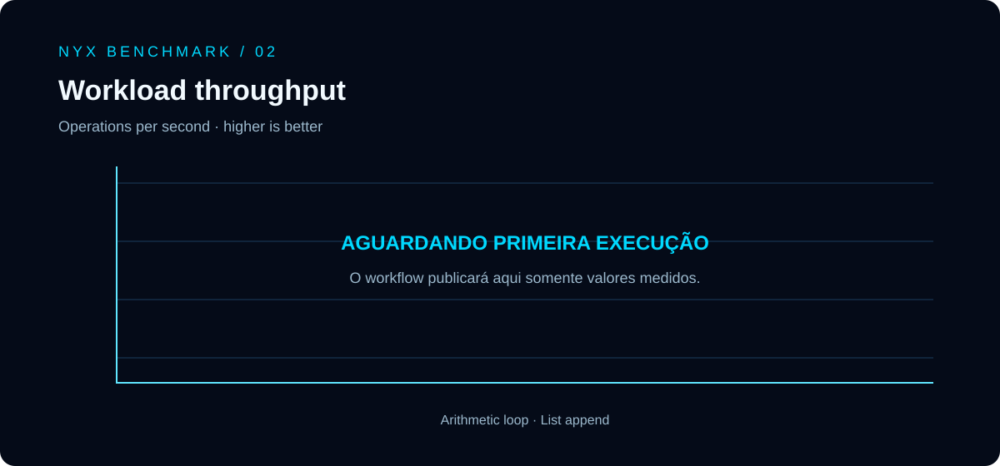

<div align="center">


# NYX — Numerical Yield eXchange

### Linguagem de programação para ciência de dados, computação científica e engenharia analítica

**Think Scientifically. Compute Intelligently.**


[Documentação](docs/ESPECIFICACAO_INICIAL.md) · [Especificação da linguagem](docs/ESPECIFICACAO_LINGUAGEM.md) · [Arquitetura](docs/ARQUITETURA.md) · [Benchmarks](#desempenho-e-benchmarking) · [Roadmap](docs/ROADMAP.md)

</div>

---

## 01. Visão científica

NYX é uma linguagem de programação autoral da NR TECH, concebida para aproximar programação, ciência de dados, computação numérica e engenharia de dados em um ambiente semântico próprio.

A proposta não é criar apenas mais uma sintaxe para automação. É desenvolver progressivamente uma linguagem com:

- gramática, AST e semântica independentes;
- estruturas de dados adequadas a computação científica;
- operações numéricas com precisão e comportamento documentados;
- abstrações para análise, transformação e validação de dados;
- execução mensurável e otimizações sustentadas por experimentos;
- interoperabilidade com bancos, APIs, linguagens e infraestruturas externas;
- ferramentas de pesquisa, profiling, testes e reprodutibilidade.

A linguagem está em estágio alfa. O runtime atual é implementado em Python, que hospeda o protótipo, mas não define a identidade nem a semântica futura da NYX.

> [!IMPORTANT]
> Estado implementado: lexer, parser recursivo descendente, AST própria, interpretador tree-walk, CLI, variáveis, expressões, controle de fluxo, funções, recursão, listas, indexação e built-ins `len()` e `append()`. Matrizes científicas, DataFrames, álgebra linear, bibliotecas estatísticas, compilação nativa, IR, paralelismo e módulos de IA ainda não fazem parte do runtime disponível.

## 02. A linguagem em código

O exemplo abaixo usa exclusivamente construções presentes no núcleo atual: funções, parâmetros, retorno, listas, indexação, laços e operações aritméticas.

### Estatística descritiva — média aritmética

```nyx
fn mean(values) {
    let total = 0
    let index = 0

    while (index < len(values)) {
        total = total + values[index]
        index = index + 1
    }

    return total / len(values)
}

let sensor_readings = [21.5, 22.0, 23.4, 24.1, 22.8]
let average = mean(sensor_readings)

print(average)
```

<details>
<summary>Resultado esperado e interpretação</summary>

A média aritmética das cinco observações é calculada pela soma dos valores dividida pelo tamanho da lista. O exemplo demonstra uma rotina estatística elementar escrita diretamente em NYX; não representa ainda uma biblioteca estatística nativa.

</details>

### Recursão e composição de funções

```nyx
fn factorial(n) {
    if (n <= 1) {
        return 1
    }

    return n * factorial(n - 1)
}

fn normalize(value, maximum) {
    return value / maximum
}

let observation = factorial(5)
let normalized = normalize(observation, 200)

print(observation)
print(normalized)
```

### Estruturas e mutabilidade

```nyx
let measurements = [18.2, 19.4, 20.1]
let matrix = [[1, 2], [3, 4]]

measurements[1] = 19.8
append(measurements, 21.3)

print(len(measurements))
print(matrix[1][0])
print(measurements[1])
```

Esses exemplos são programas executáveis no protótipo atual. Eles não dependem de APIs científicas ainda inexistentes.

## 03. Da linguagem ao ecossistema científico

A evolução da NYX está organizada em domínios especializados. A separação permite que a linguagem mantenha um núcleo coerente enquanto bibliotecas e engines evoluem com contratos próprios.

| Domínio | Problemas científicos e computacionais | Direção técnica |
|---|---|---|
| NYX Core | Sintaxe, semântica, tipos, módulos e execução | Lexer, parser, AST, runtime e sistema de tipos |
| NYX Math | Aritmética numérica e funções matemáticas | Precisão, promoção numérica e operações |
| NYX Science | Estatística, probabilidade e álgebra linear | Vetores, matrizes, distribuições e tensores |
| NYX Data | Ingestão, preparação, qualidade e análise | Series, DataFrame, Dataset e pipelines |
| NYX ML / AI | Treinamento, inferência e avaliação | APIs de modelos e integração desacoplada |
| NYX Connect | Persistência e comunicação externa | SQL, APIs, formatos e conectores |
| NYX Runtime | Execução e otimização | IR, profiling, memória e paralelismo |

Esses domínios constituem a arquitetura pretendida. Não devem ser interpretados como módulos já implementados.

### Exemplo de análise tabular — proposta de sintaxe

O exemplo seguinte ilustra a direção de uma futura API de dados. Ainda não é executável na versão alfa.

```nyx
# PROPOSTA CONCEITUAL — NYX DATA

let observations = data.read_csv("sensor_readings.csv")

let validated = observations
    |> data.filter(value != null)
    |> data.filter(status == "valid")
    |> data.select("sensor_id", "value")

let summary = validated
    |> data.group_by("sensor_id")
    |> data.aggregate(
        sample_size = count(),
        mean_value = mean(value),
        standard_deviation = std(value),
        minimum = min(value),
        maximum = max(value)
    )

summary.show()
```

O desenho dessa API exige decisões formais sobre schema, nulidade, tipos de coluna, resolução de nomes, avaliação lazy/eager, ordenação e reprodutibilidade numérica. Os exemplos conceituais estão documentados em [EXEMPLOS_CIENTIFICOS.md](docs/EXEMPLOS_CIENTIFICOS.md).

## 04. Desempenho e benchmarking

Desempenho será tratado como hipótese experimental, não como adjetivo de marketing. A suíte de benchmark da NYX mede latência, throughput e memória em workloads reproduzíveis.

### Resultados medidos

Os gráficos abaixo são gerados pelo workflow de benchmark do próprio repositório. São atualizados a partir de execuções reais; não são números ilustrativos nem dados preenchidos manualmente.

<div align="center">

#### Latência de execução


#### Throughput



#### Memória rastreada


</div>

<sub>Se os gráficos ainda não estiverem disponíveis, execute o workflow NYX reproducible benchmarks em GitHub Actions. Resultados e metadados são publicados em `benchmarks/results/`.</sub>

### O que é medido

| Métrica | Definição | Interpretação |
|---|---|---|
| Latência mediana | Mediana do tempo por execução | Custo típico do workload |
| P95 | Percentil 95 da latência observada | Comportamento da cauda da distribuição |
| Desvio-padrão | Dispersão dos tempos medidos | Variabilidade experimental |
| Throughput | Operações definidas por workload / segundo | Vazão observada |
| Pico de memória | Pico rastreado pelo `tracemalloc` | Memória alocada durante a amostra |

### Workloads e runtimes comparados

A suíte atual utiliza dois workloads pequenos e determinísticos:

1. `arithmetic_loop`: acumulação numérica em laço.
2. `list_append`: construção e crescimento de uma coleção.

Cada workload é medido em três condições:

- **NYX end-to-end:** execução completa, incluindo lexer, parser e interpretador.
- **NYX cached AST:** execução tree-walk com AST previamente construída; exclui lexer e parser da janela medida.
- **Python reference:** código de referência compilado e executado em cada amostra.

A comparação com Python é uma referência operacional, não uma afirmação de equivalência entre linguagens ou runtimes. Os resultados devem ser interpretados considerando o escopo de cada medição.

### Protocolo experimental

- 3 execuções de aquecimento por padrão;
- 25 repetições medidas por padrão;
- relógio monotônico de alta resolução (`perf_counter_ns`);
- mediana, P95 e desvio-padrão;
- rastreamento de pico de memória com `tracemalloc`;
- validação do resultado de cada workload;
- metadados de Python, sistema operacional e processador;
- CSV e JSON preservados junto aos gráficos SVG.

A suíte pode ser executada localmente:

```powershell
python -m pip install -e ".[dev]"
python -m pip install matplotlib numpy
python benchmarks/run_benchmarks.py --warmups 3 --repetitions 25
```

Arquivos produzidos:

```text
benchmarks/
└── results/
    ├── latest.csv
    └── latest.json

assets/
└── benchmarks/
    ├── latency.svg
    ├── throughput.svg
    └── memory.svg
```

O workflow automatizado está disponível em [Actions → NYX reproducible benchmarks](https://github.com/nrdataanalysis-1908/NYX-CODE/actions/workflows/benchmarks.yml).

### Limites metodológicos

Os workloads atuais são microbenchmarks do protótipo, não uma avaliação ampla de performance. Ainda não medem vetorização, operações matriciais, leitura de grandes datasets, joins, execução distribuída, GPU, concorrência ou escalabilidade. Não se deve extrapolar os resultados para esses cenários.

## 05. Arquitetura de execução

### Pipeline atualmente implementado

```text
Código-fonte .nyx
       │
       ▼
     Lexer ───────► Tokens
                       │
                       ▼
                    Parser
                       │
                       ▼
                      AST
                       │
                       ▼
              Interpretador tree-walk
                       │
              ┌────────┴────────┐
              ▼                 ▼
          Resultado         Diagnóstico
```

### Componentes do runtime

| Componente | Implementação atual | Responsabilidade |
|---|---|---|
| Lexer | `lexer.py` | Reconhecimento de tokens e posição |
| Parser | `parser.py` | Análise sintática recursiva descendente |
| AST | `ast_nodes.py` | Representação estrutural do programa |
| Interpreter | `interpreter.py` | Avaliação tree-walk |
| Errors | `errors.py` | Diagnósticos léxicos, sintáticos e de runtime |
| CLI | `cli.py` | Execução de arquivos `.nyx` |

### Evolução arquitetural em investigação

A separação entre frontend, análise semântica, representação intermediária e backend será considerada conforme a maturidade da linguagem e os resultados dos experimentos. IR, VM, compilação nativa e otimizador ainda não estão implementados.

## 06. Pesquisa, validação e qualidade

A evolução científica da NYX requer critérios verificáveis além de testes de sintaxe.

| Eixo de pesquisa | Questões experimentais |
|---|---|
| Semântica | Os resultados são determinísticos e consistentes? |
| Precisão numérica | Como erros de arredondamento se propagam? |
| Estatística | As funções respeitam definições e convenções documentadas? |
| Estruturas de dados | Como custo e memória crescem com o volume? |
| Engenharia de dados | Como schema, nulidade e qualidade são garantidos? |
| Runtime | Qual parte do tempo é consumida por lexing, parsing e avaliação? |
| Interoperabilidade | Qual é o custo de conversão entre representações? |
| Reprodutibilidade | O experimento pode ser repetido no mesmo ambiente? |

### Próximas famílias de benchmark

- aritmética escalar e operações vetoriais;
- redução, agregação e estatística descritiva;
- criação, indexação e transformação de coleções;
- matrizes, decomposições e álgebra linear;
- ingestão, filtragem, joins e agrupamentos;
- latência de chamadas e conversão entre linguagens;
- uso de memória sob diferentes cardinalidades;
- escalabilidade por tamanho de entrada.

Essas famílias são propostas para etapas futuras. Os resultados somente serão publicados quando houver implementação funcional e protocolo de medição correspondente.

## 07. Instalação e execução

### Requisitos

- Python 3.10 ou superior;
- Git.

### Instalação a partir do código-fonte

```powershell
git clone https://github.com/nrdataanalysis-1908/NYX-CODE.git
cd NYX-CODE

python -m venv .venv
.\.venv\Scripts\Activate.ps1

python -m pip install --upgrade pip
python -m pip install -e ".[dev]"
```

### Executar exemplos

```powershell
nyx run examples/00_primeiro_programa.nyx
nyx run examples/01_controle_de_fluxo.nyx
nyx run examples/02_colecoes.nyx
```

### Testes automatizados

```powershell
python -m pytest -q
```

### PyPI

O pacote publicado é [nrtech-nyx](https://pypi.org/project/nrtech-nyx/), versão `0.1.0a1`. Essa publicação é uma prévia alfa anterior e não equivale automaticamente à especificação 0.6 da linha de desenvolvimento.

```powershell
python -m pip install nrtech-nyx
```

## 08. Exemplos e documentação técnica

| Recurso | Conteúdo | Situação |
|---|---|---|
| [00_primeiro_programa.nyx](examples/00_primeiro_programa.nyx) | Declarações, expressões e saída | Executável |
| [01_controle_de_fluxo.nyx](examples/01_controle_de_fluxo.nyx) | Condicionais e laços | Executável |
| [02_colecoes.nyx](examples/02_colecoes.nyx) | Listas, indexação e mutabilidade | Executável |
| [01_analise_vendas.nyx](examples/01_analise_vendas.nyx) | Pipeline de análise comercial | Proposta conceitual |
| [02_analise_sensores.nyx](examples/02_analise_sensores.nyx) | Estatística de sensores | Proposta conceitual |
| [03_experimento_cientifico.nyx](examples/03_experimento_cientifico.nyx) | Comparação de grupos experimentais | Proposta conceitual |

Documentos de referência:

- [Especificação inicial](docs/ESPECIFICACAO_INICIAL.md)
- [Especificação da linguagem](docs/ESPECIFICACAO_LINGUAGEM.md)
- [Arquitetura](docs/ARQUITETURA.md)
- [Exemplos científicos](docs/EXEMPLOS_CIENTIFICOS.md)
- [Roadmap](docs/ROADMAP.md)

## 09. Estrutura do repositório

```text
NYX-CODE/
├── src/nyx/                 # Lexer, parser, AST, runtime e CLI
├── tests/                   # Testes automatizados
├── examples/                # Programas executáveis e propostas
├── benchmarks/              # Suíte e resultados experimentais
│   └── results/             # CSV e metadados JSON
├── assets/
│   └── benchmarks/          # Gráficos SVG gerados por medições
├── docs/                    # Especificação, arquitetura e pesquisa
├── .github/workflows/
│   ├── tests.yml            # Integração contínua
│   └── benchmarks.yml       # Execução experimental
└── pyproject.toml
```

## 10. Roadmap científico e tecnológico

| Etapa | Frente | Critério de evolução |
|---|---|---|
| 01 | Linguagem e semântica | Gramática consistente e testes de conformidade |
| 02 | Sistema de tipos | Regras explícitas e diagnósticos |
| 03 | NYX Math / Science | Operações numéricas validadas |
| 04 | NYX Data | Schema, estruturas tabulares e transformações |
| 05 | Runtime e IR | Representação intermediária e profiling |
| 06 | Performance | Benchmarks amplos e otimizações demonstradas |
| 07 | Interoperabilidade | Contratos, conectores e APIs |
| 08 | ML / AI | Interfaces de treinamento e inferência |
| 09 | Ecossistema | Pacotes, ferramentas e documentação |

## 11. Princípios de contribuição

1. Alterações sintáticas devem atualizar a especificação e os testes.
2. Recursos anunciados como implementados devem possuir código funcional.
3. Benchmarks devem incluir workload, ambiente, repetições e método.
4. Comparações devem preservar equivalência de resultado.
5. Limitações e resultados negativos também devem ser documentados.
6. Propostas conceituais devem ser identificadas como propostas.

## Licença

NYX é distribuída sob a licença [Apache License 2.0](LICENSE).

<div align="center">


**NYX · NR TECH**

*Think Scientifically. Compute Intelligently.*

</div>
