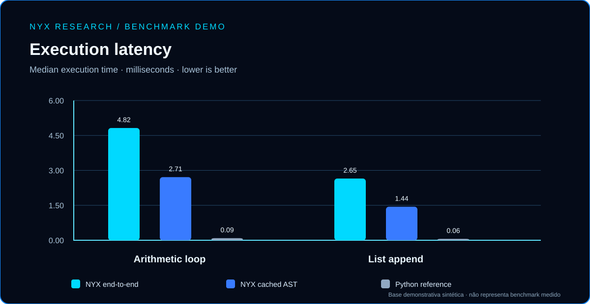
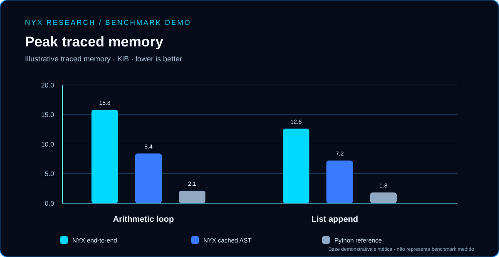
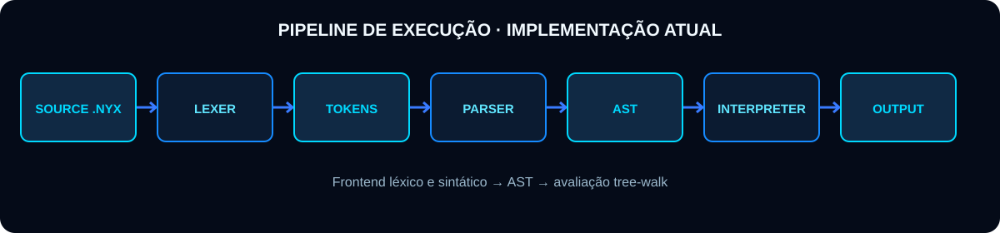

<div align="center">


# NYX — Numerical Yield eXchange

### Linguagem de programação para ciência de dados, computação científica e engenharia analítica

**Think Scientifically. Compute Intelligently.**


[Documentação](docs/ESPECIFICACAO_INICIAL.md) · [Especificação da linguagem](docs/ESPECIFICACAO_LINGUAGEM.md) · [Arquitetura](docs/ARQUITETURA.md) · [Benchmarks](#desempenho-e-benchmarking) · [Roadmap](docs/ROADMAP.md)

</div>

---

## 01. Visão científica

NYX é uma linguagem de programação autoral da NR TECH, concebida para aproximar programação, ciência de dados, computação numérica e engenharia de dados em um ambiente semântico próprio.

A proposta não é criar apenas mais uma sintaxe para automação. É desenvolver progressivamente uma linguagem com:

- gramática, AST e semântica independentes;
- estruturas de dados adequadas a computação científica;
- operações numéricas com precisão e comportamento documentados;
- abstrações para análise, transformação e validação de dados;
- execução mensurável e otimizações sustentadas por experimentos;
- interoperabilidade com bancos, APIs, linguagens e infraestruturas externas;
- ferramentas de pesquisa, profiling, testes e reprodutibilidade.

A linguagem está em estágio alfa. O runtime atual é implementado em Python, que hospeda o protótipo, mas não define a identidade nem a semântica futura da NYX.

> [!IMPORTANT]
> Estado implementado: lexer, parser recursivo descendente, AST própria, interpretador tree-walk, CLI, variáveis, expressões, controle de fluxo, funções, recursão, listas, indexação e built-ins `len()` e `append()`. Matrizes científicas, DataFrames, álgebra linear, bibliotecas estatísticas, compilação nativa, IR, paralelismo e módulos de IA ainda não fazem parte do runtime disponível.

## 02. A linguagem em código

O exemplo abaixo usa exclusivamente construções presentes no núcleo atual: funções, parâmetros, retorno, listas, indexação, laços e operações aritméticas.

### Estatística descritiva — média aritmética

```nyx
fn mean(values) {
    let total = 0
    let index = 0

    while (index < len(values)) {
        total = total + values[index]
        index = index + 1
    }

    return total / len(values)
}

let sensor_readings = [21.5, 22.0, 23.4, 24.1, 22.8]
let average = mean(sensor_readings)

print(average)
```

<details>
<summary>Resultado esperado e interpretação</summary>

A média aritmética das cinco observações é calculada pela soma dos valores dividida pelo tamanho da lista. O exemplo demonstra uma rotina estatística elementar escrita diretamente em NYX; não representa ainda uma biblioteca estatística nativa.

</details>

### Recursão e composição de funções

```nyx
fn factorial(n) {
    if (n <= 1) {
        return 1
    }

    return n * factorial(n - 1)
}

fn normalize(value, maximum) {
    return value / maximum
}

let observation = factorial(5)
let normalized = normalize(observation, 200)

print(observation)
print(normalized)
```

### Estruturas e mutabilidade

```nyx
let measurements = [18.2, 19.4, 20.1]
let matrix = [[1, 2], [3, 4]]

measurements[1] = 19.8
append(measurements, 21.3)

print(len(measurements))
print(matrix[1][0])
print(measurements[1])
```

Esses exemplos são programas executáveis no protótipo atual. Eles não dependem de APIs científicas ainda inexistentes.

## 03. Da linguagem ao ecossistema científico

A evolução da NYX está organizada em domínios especializados. A separação permite que a linguagem mantenha um núcleo coerente enquanto bibliotecas e engines evoluem com contratos próprios.

| Domínio | Problemas científicos e computacionais | Direção técnica |
|---|---|---|
| NYX Core | Sintaxe, semântica, tipos, módulos e execução | Lexer, parser, AST, runtime e sistema de tipos |
| NYX Math | Aritmética numérica e funções matemáticas | Precisão, promoção numérica e operações |
| NYX Science | Estatística, probabilidade e álgebra linear | Vetores, matrizes, distribuições e tensores |
| NYX Data | Ingestão, preparação, qualidade e análise | Series, DataFrame, Dataset e pipelines |
| NYX ML / AI | Treinamento, inferência e avaliação | APIs de modelos e integração desacoplada |
| NYX Connect | Persistência e comunicação externa | SQL, APIs, formatos e conectores |
| NYX Runtime | Execução e otimização | IR, profiling, memória e paralelismo |

Esses domínios constituem a arquitetura pretendida. Não devem ser interpretados como módulos já implementados.

### Exemplo de análise tabular — proposta de sintaxe

O exemplo seguinte ilustra a direção de uma futura API de dados. Ainda não é executável na versão alfa.

```nyx
# PROPOSTA CONCEITUAL — NYX DATA

let observations = data.read_csv("sensor_readings.csv")

let validated = observations
    |> data.filter(value != null)
    |> data.filter(status == "valid")
    |> data.select("sensor_id", "value")

let summary = validated
    |> data.group_by("sensor_id")
    |> data.aggregate(
        sample_size = count(),
        mean_value = mean(value),
        standard_deviation = std(value),
        minimum = min(value),
        maximum = max(value)
    )

summary.show()
```

O desenho dessa API exige decisões formais sobre schema, nulidade, tipos de coluna, resolução de nomes, avaliação lazy/eager, ordenação e reprodutibilidade numérica. Os exemplos conceituais estão documentados em [EXEMPLOS_CIENTIFICOS.md](docs/EXEMPLOS_CIENTIFICOS.md).

## 04. Desempenho e benchmarking

Desempenho será tratado como hipótese experimental, não como adjetivo de marketing. A suíte de benchmark da NYX mede latência, throughput e memória em workloads reproduzíveis.

### Painel demonstrativo — dados simulados

Os gráficos abaixo já estão preenchidos com uma base sintética para demonstrar como a documentação apresentará as métricas. Não são medições reais da NYX. Os valores foram construídos apenas para ilustrar escalas, comparação entre runtimes, unidades e leitura visual.

> [!WARNING]
> DADOS SIMULADOS. Não use estes valores como evidência de desempenho, benchmark oficial, comparação de mercado ou resultado experimental do runtime NYX. A base está identificada como `SYNTHETIC_DEMONSTRATION_NOT_MEASURED`. Ela será substituída por medições reproduzíveis quando o workflow de benchmark for executado com sucesso.

<div align="center">

#### Latência mediana por workload



#### Vazão estimada por workload


#### Pico de memória rastreada



</div>

### Dataset demonstrativo

A tabela abaixo reproduz os valores usados nos gráficos. Ela existe para validar a estrutura de apresentação e o pipeline de documentação, não para caracterizar a performance atual da linguagem.

| Workload | Runtime | Mediana (ms) | P95 (ms) | Desvio-padrão (ms) | Throughput (op/s) | Memória (KiB) |
|---|---|---:|---:|---:|---:|---:|
| arithmetic_loop | NYX end-to-end | 4,82 | 5,21 | 0,31 | 62.240 | 15,8 |
| arithmetic_loop | NYX cached AST | 2,71 | 2,94 | 0,16 | 110.701 | 8,4 |
| arithmetic_loop | Python reference | 0,09 | 0,12 | 0,01 | 3.333.333 | 2,1 |
| list_append | NYX end-to-end | 2,65 | 2,91 | 0,19 | 56.604 | 12,6 |
| list_append | NYX cached AST | 1,44 | 1,62 | 0,11 | 104.167 | 7,2 |
| list_append | Python reference | 0,06 | 0,08 | 0,01 | 2.500.000 | 1,8 |

Arquivos de origem:

- [CSV sintético](benchmarks/results/demo_synthetic.csv)
- [JSON sintético com classificação e aviso](benchmarks/results/demo_synthetic.json)
- [Gerador de metadados demonstrativos](benchmarks/generate_demo.py)

A coluna `NYX cached AST` representa somente uma hipótese de custo de avaliação sem lexing e parsing dentro da janela medida. A coluna `Python reference` é uma referência didática. Não se deve interpretar a diferença como uma razão universal de velocidade entre linguagens.

### O que é medido

| Métrica | Definição | Interpretação |
|---|---|---|
| Latência mediana | Mediana do tempo por execução | Custo típico do workload |
| P95 | Percentil 95 da latência observada | Comportamento da cauda da distribuição |
| Desvio-padrão | Dispersão dos tempos medidos | Variabilidade experimental |
| Throughput | Operações definidas por workload / segundo | Vazão observada |
| Pico de memória | Pico rastreado pelo `tracemalloc` | Memória alocada durante a amostra |

### Workloads e runtimes comparados

A suíte atual utiliza dois workloads pequenos e determinísticos:

1. `arithmetic_loop`: acumulação numérica em laço.
2. `list_append`: construção e crescimento de uma coleção.

Cada workload é medido em três condições:

- **NYX end-to-end:** execução completa, incluindo lexer, parser e interpretador.
- **NYX cached AST:** execução tree-walk com AST previamente construída; exclui lexer e parser da janela medida.
- **Python reference:** código de referência compilado e executado em cada amostra.

A comparação com Python é uma referência operacional, não uma afirmação de equivalência entre linguagens ou runtimes. Os resultados devem ser interpretados considerando o escopo de cada medição.

### Protocolo experimental

- 3 execuções de aquecimento por padrão;
- 25 repetições medidas por padrão;
- relógio monotônico de alta resolução (`perf_counter_ns`);
- mediana, P95 e desvio-padrão;
- rastreamento de pico de memória com `tracemalloc`;
- validação do resultado de cada workload;
- metadados de Python, sistema operacional e processador;
- CSV e JSON preservados junto aos gráficos SVG.

A suíte pode ser executada localmente:

```powershell
python -m pip install -e ".[dev]"
python -m pip install matplotlib numpy
python benchmarks/run_benchmarks.py --warmups 3 --repetitions 25
```

Arquivos produzidos:

```text
benchmarks/
└── results/
    ├── latest.csv
    └── latest.json

assets/
└── benchmarks/
    ├── latency.svg
    ├── throughput.svg
    └── memory.svg
```

O workflow automatizado está disponível em [Actions → NYX reproducible benchmarks](https://github.com/nrdataanalysis-1908/NYX-CODE/actions/workflows/benchmarks.yml).

### Limites metodológicos

Os workloads atuais são microbenchmarks do protótipo, não uma avaliação ampla de performance. Ainda não medem vetorização, operações matriciais, leitura de grandes datasets, joins, execução distribuída, GPU, concorrência ou escalabilidade. Não se deve extrapolar os resultados para esses cenários.

## 05. Arquitetura de execução

### Pipeline atualmente implementado



A sequência acima representa o caminho efetivamente implementado no protótipo. A camada de frontend transforma o código-fonte em tokens, o parser constrói a AST e o interpretador avalia os nós. O fluxo de diagnóstico acompanha erros léxicos, sintáticos e de execução.

### Componentes do runtime

| Componente | Implementação atual | Responsabilidade |
|---|---|---|
| Lexer | `lexer.py` | Reconhecimento de tokens e posição |
| Parser | `parser.py` | Análise sintática recursiva descendente |
| AST | `ast_nodes.py` | Representação estrutural do programa |
| Interpreter | `interpreter.py` | Avaliação tree-walk |
| Errors | `errors.py` | Diagnósticos léxicos, sintáticos e de runtime |
| CLI | `cli.py` | Execução de arquivos `.nyx` |

### Evolução arquitetural em investigação

A separação entre frontend, análise semântica, representação intermediária e backend será considerada conforme a maturidade da linguagem e os resultados dos experimentos. IR, VM, compilação nativa e otimizador ainda não estão implementados.

## 06. Pesquisa, validação e qualidade

A evolução científica da NYX requer critérios verificáveis além de testes de sintaxe.

| Eixo de pesquisa | Questões experimentais |
|---|---|
| Semântica | Os resultados são determinísticos e consistentes? |
| Precisão numérica | Como erros de arredondamento se propagam? |
| Estatística | As funções respeitam definições e convenções documentadas? |
| Estruturas de dados | Como custo e memória crescem com o volume? |
| Engenharia de dados | Como schema, nulidade e qualidade são garantidos? |
| Runtime | Qual parte do tempo é consumida por lexing, parsing e avaliação? |
| Interoperabilidade | Qual é o custo de conversão entre representações? |
| Reprodutibilidade | O experimento pode ser repetido no mesmo ambiente? |

### Próximas famílias de benchmark

- aritmética escalar e operações vetoriais;
- redução, agregação e estatística descritiva;
- criação, indexação e transformação de coleções;
- matrizes, decomposições e álgebra linear;
- ingestão, filtragem, joins e agrupamentos;
- latência de chamadas e conversão entre linguagens;
- uso de memória sob diferentes cardinalidades;
- escalabilidade por tamanho de entrada.

Essas famílias são propostas para etapas futuras. Os resultados somente serão publicados quando houver implementação funcional e protocolo de medição correspondente.

## 07. Instalação e execução

### Requisitos

- Python 3.10 ou superior;
- Git.

### Instalação a partir do código-fonte

```powershell
git clone https://github.com/nrdataanalysis-1908/NYX-CODE.git
cd NYX-CODE

python -m venv .venv
.\.venv\Scripts\Activate.ps1

python -m pip install --upgrade pip
python -m pip install -e ".[dev]"
```

### Executar exemplos

```powershell
nyx run examples/00_primeiro_programa.nyx
nyx run examples/01_controle_de_fluxo.nyx
nyx run examples/02_colecoes.nyx
```

### Testes automatizados

```powershell
python -m pytest -q
```

### PyPI

O pacote publicado é [nrtech-nyx](https://pypi.org/project/nrtech-nyx/), versão `0.1.0a1`. Essa publicação é uma prévia alfa anterior e não equivale automaticamente à especificação 0.6 da linha de desenvolvimento.

```powershell
python -m pip install nrtech-nyx
```

## 08. Exemplos e documentação técnica

| Recurso | Conteúdo | Situação |
|---|---|---|
| [00_primeiro_programa.nyx](examples/00_primeiro_programa.nyx) | Declarações, expressões e saída | Executável |
| [01_controle_de_fluxo.nyx](examples/01_controle_de_fluxo.nyx) | Condicionais e laços | Executável |
| [02_colecoes.nyx](examples/02_colecoes.nyx) | Listas, indexação e mutabilidade | Executável |
| [01_analise_vendas.nyx](examples/01_analise_vendas.nyx) | Pipeline de análise comercial | Proposta conceitual |
| [02_analise_sensores.nyx](examples/02_analise_sensores.nyx) | Estatística de sensores | Proposta conceitual |
| [03_experimento_cientifico.nyx](examples/03_experimento_cientifico.nyx) | Comparação de grupos experimentais | Proposta conceitual |

Documentos de referência:

- [Especificação inicial](docs/ESPECIFICACAO_INICIAL.md)
- [Especificação da linguagem](docs/ESPECIFICACAO_LINGUAGEM.md)
- [Arquitetura](docs/ARQUITETURA.md)
- [Exemplos científicos](docs/EXEMPLOS_CIENTIFICOS.md)
- [Roadmap](docs/ROADMAP.md)

## 09. Estrutura do repositório

```text
NYX-CODE/
├── src/nyx/                 # Lexer, parser, AST, runtime e CLI
├── tests/                   # Testes automatizados
├── examples/                # Programas executáveis e propostas
├── benchmarks/              # Suíte e resultados experimentais
│   └── results/             # CSV e metadados JSON
├── assets/
│   └── benchmarks/          # Gráficos SVG gerados por medições
├── docs/                    # Especificação, arquitetura e pesquisa
├── .github/workflows/
│   ├── tests.yml            # Integração contínua
│   └── benchmarks.yml       # Execução experimental
└── pyproject.toml
```

## 10. Roadmap científico e tecnológico

| Etapa | Frente | Critério de evolução |
|---|---|---|
| 01 | Linguagem e semântica | Gramática consistente e testes de conformidade |
| 02 | Sistema de tipos | Regras explícitas e diagnósticos |
| 03 | NYX Math / Science | Operações numéricas validadas |
| 04 | NYX Data | Schema, estruturas tabulares e transformações |
| 05 | Runtime e IR | Representação intermediária e profiling |
| 06 | Performance | Benchmarks amplos e otimizações demonstradas |
| 07 | Interoperabilidade | Contratos, conectores e APIs |
| 08 | ML / AI | Interfaces de treinamento e inferência |
| 09 | Ecossistema | Pacotes, ferramentas e documentação |

## 11. Princípios de contribuição

1. Alterações sintáticas devem atualizar a especificação e os testes.
2. Recursos anunciados como implementados devem possuir código funcional.
3. Benchmarks devem incluir workload, ambiente, repetições e método.
4. Comparações devem preservar equivalência de resultado.
5. Limitações e resultados negativos também devem ser documentados.
6. Propostas conceituais devem ser identificadas como propostas.


---

# Caderno técnico de pesquisa

As seções seguintes aprofundam as decisões de arquitetura, o desenho experimental e os domínios científicos que orientam a evolução da NYX. O objetivo é documentar não apenas o que existe no protótipo, mas também os critérios pelos quais novos recursos deverão ser especificados, implementados, testados e avaliados.

## 12. Modelo de maturidade dos recursos

Para evitar que intenção arquitetural seja confundida com funcionalidade disponível, a documentação utiliza quatro estados explícitos.

| Estado | Significado | Evidência exigida |
|---|---|---|
| Implementado | Existe no código e pode ser executado | Código, testes e exemplo funcional |
| Experimental | Existe em branch ou protótipo isolado | Implementação identificada, limitações e testes |
| Especificado | Contrato ou proposta técnica documentada | Sintaxe, semântica e decisões registradas |
| Planejado | Ideia priorizada para evolução | Objetivo e critérios de entrada no roadmap |

Uma funcionalidade somente poderá migrar para “implementado” quando houver código integrado, testes automatizados e documentação coerente. Um exemplo de sintaxe futura não constitui prova de implementação.

### Matriz de maturidade por domínio

| Domínio | Estado nesta versão | Próxima evidência necessária |
|---|---|---|
| Lexer | Implementado | Testes de cobertura de tokens e posições |
| Parser | Implementado | Testes de precedência e recuperação de erros |
| AST | Implementado | Contratos de nós e invariantes |
| Interpretador | Implementado | Semântica formal e testes de regressão |
| CLI | Implementado | Contratos de argumentos e códigos de saída |
| Sistema de tipos | Planejado | Especificação de tipos e regras de coerção |
| NYX Math | Planejado | Biblioteca numérica validada |
| NYX Data | Planejado | Schema, colunas e operações tabulares |
| NYX Science | Planejado | Estatística, probabilidade e álgebra linear |
| IR / VM | Planejado | Modelo de instruções e semântica de execução |
| Compilação nativa | Planejado | Backend e suíte de conformidade |
| Paralelismo | Planejado | Modelo de concorrência e segurança de memória |
| ML / AI | Planejado | Interfaces, contratos de dados e avaliação |

## 13. Semântica e desenho da linguagem

Uma linguagem científica precisa de semântica previsível. A forma visual de uma expressão não basta: operadores, tipos, escopo, mutabilidade, avaliação e erros devem ter regras explícitas.

### 13.1 Expressões e precedência

A evolução do parser deverá manter uma tabela de precedência documentada. A ordem precisa ser testada com expressões equivalentes e casos de associação.

| Família | Exemplos | Questões semânticas |
|---|---|---|
| Agrupamento | `(a + b)` | Agrupamento explícito |
| Unários | `-x`, `!flag` | Associação e domínio |
| Multiplicativos | `a * b`, `a / b` | Divisão, overflow e precisão |
| Aditivos | `a + b`, `a - b` | Promoção e compatibilidade |
| Comparação | `a < b`, `a >= b` | Comparação entre tipos |
| Igualdade | `a == b` | Igualdade estrutural ou referencial |
| Lógicos | `and`, `or` | Curto-circuito e avaliação |

A tabela representa tópicos que precisam ser consolidados na especificação. Ela não afirma que todas as famílias estejam integralmente disponíveis no runtime atual.

### 13.2 Escopo e ambiente de execução

O ambiente de execução deverá explicitar como variáveis são declaradas, consultadas, atualizadas e removidas. Questões relevantes incluem:

- escopo léxico versus escopo dinâmico;
- resolução de nomes locais e globais;
- sombreamento de identificadores;
- mutabilidade de bindings e objetos;
- ciclo de vida de funções e closures;
- comportamento de variáveis não inicializadas;
- isolamento entre módulos;
- rastreabilidade de erros até a posição original no código.

### 13.3 Tipos numéricos e precisão

A computação científica exige que o modelo numérico seja explícito. A evolução de NYX Math deverá documentar:

- inteiros de largura fixa ou precisão arbitrária;
- números de ponto flutuante e padrão IEEE 754;
- conversões implícitas e explícitas;
- overflow e underflow;
- NaN, infinito e valores não finitos;
- arredondamento e representação decimal;
- comparação aproximada e tolerâncias;
- estabilidade numérica de algoritmos;
- propagação de incerteza.

Não é suficiente que uma operação “funcione” em um exemplo. O contrato deverá indicar quais valores aceita, quais resultados produz e como se comporta nos limites.

## 14. Arquitetura lógica do ecossistema

A arquitetura proposta separa a linguagem central de seus domínios científicos. Essa separação reduz acoplamento e permite que componentes evoluam em ritmos diferentes.

| Camada | Responsabilidade | Interfaces esperadas |
|---|---|---|
| Language Frontend | Léxico, sintaxe, AST e semântica | Tokens, nós e diagnósticos |
| Semantic Layer | Tipos, escopo e validação | Símbolos, tipos e regras |
| Runtime | Avaliação e gerenciamento de execução | Contexto, valores e exceções |
| Numerical Core | Operações matemáticas | Escalares, vetores e matrizes |
| Data Engine | Estruturas tabulares e transformação | Schema, Series e DataFrame |
| IO / Connectors | Leitura e escrita externa | Arquivos, bancos e APIs |
| Execution Backend | Otimização e execução alternativa | IR, VM e compiladores |
| Scientific Tooling | Profiling, benchmark e reprodutibilidade | Métricas, traces e relatórios |

### 14.1 Separação entre frontend e backend

O frontend é responsável por interpretar o texto da linguagem e construir uma representação estruturada. O backend é responsável por executar essa representação. A separação futura permitirá múltiplas estratégias de execução sem alterar a sintaxe da linguagem.

**Frontend:**

1. leitura do código-fonte;
2. tokenização;
3. parsing;
4. construção da AST;
5. validação semântica;
6. emissão de diagnósticos.

**Backend — direção futura:**

1. transformação da AST;
2. geração de representação intermediária;
3. otimizações verificáveis;
4. seleção de backend;
5. execução;
6. coleta de métricas e profiling.

A implementação atual termina na avaliação tree-walk da AST. As etapas de IR, otimização e backend permanecem no planejamento.

### 14.2 Contratos entre componentes

| Contrato | Entrada | Saída | Invariante |
|---|---|---|---|
| Lexer | Texto-fonte | Sequência de tokens | Posições rastreáveis |
| Parser | Tokens | AST | Estrutura sintática válida |
| Semantic Analyzer | AST | Diagnósticos e símbolos | Regras semânticas explícitas |
| Runtime | AST validada | Valores e efeitos | Semântica determinística |
| Data Engine | Dataset e operações | Dataset transformado | Schema preservado ou alterado explicitamente |
| Connector | Requisição tipada | Dados ou erro | Falhas e conversões rastreáveis |

## 15. Engenharia de dados — modelo de pipeline

O domínio NYX Data deverá tratar dados como objetos com schema, proveniência e regras de qualidade, em vez de apenas coleções genéricas.

### 15.1 Ciclo de vida proposto

```text
ORIGENS
  │
  ├── Arquivos CSV / Parquet
  ├── Bancos SQL
  ├── APIs REST
  └── Streams e eventos
  │
  ▼
INGESTÃO
  │  Conectores, encoding, parsing, schema inicial
  ▼
VALIDAÇÃO
  │  Tipos, nulidade, domínio, duplicidade, constraints
  ▼
TRANSFORMAÇÃO
  │  Filtros, projeções, joins, agregações, janelas
  ▼
QUALIDADE
  │  Regras, métricas, rejeições e linhagem
  ▼
SAÍDA
     Arquivos, tabelas, APIs e consumo analítico
```

### 15.2 Contrato de Dataset

Um Dataset deverá possuir, no mínimo, metadados capazes de descrever:

| Campo conceitual | Finalidade |
|---|---|
| name | Identificação lógica |
| schema | Colunas e tipos |
| row_count | Quantidade de registros, quando conhecida |
| source | Origem dos dados |
| created_at | Momento de criação |
| updated_at | Última transformação |
| nullability | Política de valores ausentes |
| constraints | Regras de integridade |
| lineage | Origem e transformações aplicadas |
| statistics | Estatísticas descritivas disponíveis |

Esse contrato é uma proposta de arquitetura. Não existe ainda um objeto Dataset nativo no protótipo.

### 15.3 Qualidade de dados

A evolução da linguagem deverá considerar verificações sistemáticas de qualidade:

- completude: proporção de valores ausentes;
- unicidade: duplicidade em chaves candidatas;
- validade: conformidade com domínio e formato;
- consistência: coerência entre campos relacionados;
- integridade: cumprimento de constraints;
- atualidade: idade e atraso dos dados;
- distribuição: alterações relevantes em estatísticas;
- proveniência: rastreabilidade da fonte e das transformações.

### 15.4 Métricas de pipeline

| Métrica | Unidade | Uso |
|---|---|---|
| Input rows | registros | Volume recebido |
| Output rows | registros | Volume produzido |
| Rejected rows | registros | Registros rejeitados |
| Processing time | ms / s | Tempo de transformação |
| Throughput | registros/s | Vazão |
| Data freshness | s / min / h | Atualidade |
| Null rate | % | Completude |
| Duplicate rate | % | Unicidade |
| Schema drift | eventos | Alterações estruturais |

## 16. Computação científica e análise estatística

NYX Science deverá oferecer primitivas numéricas consistentes, com documentação de domínio, precisão, complexidade e comportamento em casos extremos.

### 16.1 Estatística descritiva

O conjunto inicial de funções em estudo inclui:

| Função | Definição | Cuidados |
|---|---|---|
| mean | Média aritmética | Sensibilidade a outliers |
| median | Mediana | Ordenação e custo |
| variance | Variância | População versus amostra |
| std | Desvio-padrão | Estabilidade numérica |
| quantile | Quantil | Método de interpolação |
| min / max | Extremos | Valores ausentes e NaN |
| count | Contagem | Nulidade e filtros |
| covariance | Covariância | Normalização |
| correlation | Correlação | Variância nula e domínio |

### 16.2 Inferência estatística

A evolução deverá contemplar, de maneira progressiva e validada:

- distribuições de probabilidade;
- intervalos de confiança;
- testes de hipóteses;
- erros tipo I e tipo II;
- tamanho de efeito;
- poder estatístico;
- bootstrap;
- regressão;
- análise de resíduos;
- diagnóstico de pressupostos.

### 16.3 Reprodutibilidade numérica

Uma execução científica precisa registrar versão da linguagem, versão das bibliotecas, ambiente, parâmetros, sementes aleatórias e origem dos dados. Quando houver aleatoriedade, a API deverá permitir controle explícito da seed e documentar o alcance da reprodutibilidade.

## 17. Aprendizado de máquina e inteligência artificial

O domínio NYX ML / AI deverá ser concebido como integração de capacidades, e não como uma coleção de nomes de algoritmos sem contratos de dados.

### Ciclo de vida de ML proposto

```text
DATASET
   │
   ▼
FEATURE ENGINEERING
   │
   ▼
TRAIN / VALIDATION / TEST
   │
   ▼
MODEL TRAINING
   │
   ▼
EVALUATION
   │
   ├── Accuracy / Precision / Recall / F1
   ├── ROC-AUC / PR-AUC
   ├── MAE / MSE / RMSE
   └── Calibration / Error analysis
   │
   ▼
MODEL REGISTRY
   │
   ▼
INFERENCE / MONITORING
```

### Métricas de avaliação por problema

| Tipo de problema | Métricas possíveis |
|---|---|
| Classificação binária | Precision, Recall, F1, ROC-AUC, PR-AUC |
| Classificação multiclasse | Macro-F1, Micro-F1, matriz de confusão |
| Regressão | MAE, MSE, RMSE, R² |
| Clustering | Silhouette, Davies–Bouldin, estabilidade |
| Ranking | NDCG, MAP, MRR |
| Detecção de anomalias | Precision@K, Recall@K, taxa de falsos positivos |

A documentação deverá distinguir métricas de treino, validação e teste. Também deverá registrar vazamento de dados, desbalanceamento, calibração, deriva e custo de inferência.

### Integração com LLMs

Uma possível camada de integração deverá padronizar:

- provedores e modelos;
- autenticação e configuração;
- templates e parâmetros;
- embeddings e dimensões;
- bancos vetoriais;
- recuperação contextual (RAG);
- avaliação de respostas;
- latência, tokens e custo;
- observabilidade e rastreabilidade.

Esses itens são direcionamentos futuros e não funcionalidades presentes na versão alfa.

## 18. Interoperabilidade e integração

A interoperabilidade será construída sobre contratos explícitos, formatos estáveis e fronteiras bem definidas entre sistemas.

| Fronteira | Possível integração | Questão técnica |
|---|---|---|
| Linguagens | Python, C, Rust e outras | ABI, FFI e conversão de tipos |
| Dados | CSV, JSON, Parquet e Arrow | Schema, encoding e zero-copy |
| Bancos | PostgreSQL e outros SQL | Tipos, transações e pooling |
| APIs | HTTP / REST | Serialização, autenticação e retry |
| Mensageria | Filas e streams | Ordenação, entrega e backpressure |
| IA | Frameworks e serviços de modelos | Tensores, embeddings e inferência |

## 19. Observabilidade e profiling do runtime

A observabilidade deverá permitir responder onde o tempo é gasto, quais operações consomem memória e quais etapas degradam a execução.

### Métricas de runtime propostas

| Métrica | Unidade | Descrição |
|---|---|---|
| lex_duration | µs / ms | Tempo de tokenização |
| parse_duration | µs / ms | Tempo de parsing |
| semantic_duration | µs / ms | Tempo de validação semântica |
| execution_duration | µs / ms | Tempo de avaliação |
| total_duration | µs / ms | Tempo total |
| token_count | tokens | Volume léxico |
| ast_node_count | nós | Tamanho estrutural |
| function_calls | chamadas | Frequência de funções |
| allocations | eventos / bytes | Pressão de alocação |
| peak_memory | bytes | Pico de memória |
| error_count | ocorrências | Diagnósticos e falhas |

### Latência: decomposição correta

A latência total não deve ser tratada como uma caixa-preta. O desenho de instrumentação deverá decompor o tempo por etapa:

```text
T_total = T_lex + T_parse + T_semantic + T_runtime + T_io
```

A expressão é um modelo conceitual de decomposição. Componentes ainda não implementados, como análise semântica separada, não devem ser reportados como se já tivessem sido medidos.

### Profiling e gargalos

A investigação de performance deverá distinguir:

- custo fixo de inicialização;
- custo de tokenização por caractere;
- custo de parsing por token;
- custo de avaliação por nó da AST;
- custo de chamadas de função;
- custo de alocação e coleta;
- custo de entrada e saída;
- custo de conversão entre estruturas;
- custo de interoperabilidade.

## 20. Metodologia de benchmarking

A qualidade de uma comparação depende tanto do desenho experimental quanto da implementação do benchmark.

### 20.1 Definição da hipótese

Todo experimento deve declarar:

1. hipótese;
2. variável independente;
3. variável dependente;
4. workload;
5. ambiente;
6. baseline;
7. critérios de aceitação;
8. limitações conhecidas.

### 20.2 Controle experimental

- Fixar versões de runtime e dependências.
- Registrar CPU, memória, sistema operacional e arquitetura.
- Separar aquecimento de amostras medidas.
- Repetir as execuções.
- Validar o resultado funcional de cada amostra.
- Evitar processos concorrentes e carga externa quando possível.
- Preservar dados brutos, não apenas médias.
- Documentar qualquer alteração no workload.
- Não misturar resultados de máquinas diferentes sem identificação.
- Não comparar operações semanticamente diferentes como se fossem equivalentes.

### 20.3 Estatísticas de latência

A mediana reduz a influência de valores extremos. O P95 descreve a cauda superior da distribuição. O desvio-padrão ajuda a avaliar dispersão, mas deve ser interpretado junto com a distribuição completa e o número de amostras.

Para experimentos mais amplos, a NYX deverá preservar amostras individuais, percentis adicionais, intervalos de confiança e, quando pertinente, bootstrap.

### 20.4 Throughput

O throughput deve especificar o que conta como operação. Em um laço, pode ser o número de iterações; em um pipeline, o número de registros processados; em uma API, o número de requisições concluídas.

```text
throughput = quantidade_de_operacoes / tempo_total_em_segundos
```

A unidade deverá acompanhar o resultado. “Operações por segundo” sem definição da operação não é uma métrica comparável.

### 20.5 Memória

A métrica de memória deverá declarar o mecanismo utilizado. `tracemalloc` mede alocações rastreadas pelo alocador Python e não representa necessariamente todo o RSS do processo, memória nativa, GPU ou memória compartilhada. Para estudos mais completos, será necessário coletar métricas adicionais do processo e do sistema.

### 20.6 Comparabilidade entre runtimes

Uma comparação justa exige equivalência de saída, workload, tamanho de entrada e escopo medido. O benchmark deve indicar se inclui compilação, parsing, inicialização, I/O e conversões. A comparação NYX end-to-end versus Python reference, por exemplo, não é uma comparação entre compiladores nativos equivalentes: o protótipo NYX é interpretado e hospedado em Python.

## 21. Plano de benchmark em escala

A suíte atual é deliberadamente pequena. Uma bateria de pesquisa mais abrangente deverá crescer por famílias de workloads, com dados de entrada versionados e resultados rastreáveis.

| Família | Tamanho de entrada | Métrica primária | Métricas secundárias |
|---|---|---|---|
| Lexer | 1 KB a 10 MB de fonte | MB/s e latência | tokens/s, memória |
| Parser | 10² a 10⁶ tokens | tokens/s | nós AST/s, memória |
| Runtime | 10² a 10⁷ operações | operações/s | P95, memória |
| Funções | 10³ a 10⁶ chamadas | chamadas/s | profundidade, overhead |
| Coleções | 10² a 10⁷ elementos | tempo de operação | bytes/elemento |
| DataFrame | 10⁴ a 10⁸ linhas | linhas/s | memória, cardinalidade |
| Joins | chaves com diferentes cardinalidades | tempo total | skew, memória |
| Álgebra linear | matrizes de dimensões crescentes | GFLOP/s | erro numérico |
| I/O | arquivos de diferentes formatos e tamanhos | MB/s | CPU, memória |
| Interoperabilidade | lotes de tamanhos variados | chamadas/s | custo de conversão |

### Matriz de crescimento

| Dimensão | Cenários | Pergunta |
|---|---|---|
| Tamanho | Pequeno, médio, grande | Como cresce o custo? |
| Cardinalidade | Baixa, média, alta | Como cresce a memória? |
| Distribuição | Uniforme, assimétrica, esparsa | Há sensibilidade à distribuição? |
| Concorrência | 1, 2, 4, 8, 16 workers | Há ganho ou contenção? |
| Persistência | Cache frio e aquecido | Qual o custo de I/O? |
| Precisão | FP32, FP64, decimal | Qual o trade-off entre erro e custo? |

## 22. Estratégia de testes e conformidade

A evolução da linguagem deve ser guiada por testes em camadas.

| Camada | O que valida | Exemplo |
|---|---|---|
| Lexer unitário | Reconhecimento de tokens | Identificadores e literais |
| Parser unitário | Construção da AST | Precedência e agrupamento |
| Runtime unitário | Semântica de nós | Operações e escopo |
| Integração | Fluxo completo | Arquivo .nyx executado |
| Regressão | Comportamentos preservados | Bugs corrigidos |
| Propriedade | Invariantes em muitos casos | Parser não falha sem diagnóstico |
| Fuzzing | Robustez a entradas inesperadas | Sequências aleatórias de tokens |
| Performance | Regressões mensuráveis | Latência por workload |
| Conformidade | Compatibilidade com especificação | Casos normativos |

### Critérios mínimos para novas funcionalidades

1. Especificação antes ou junto da implementação.
2. Testes positivos e negativos.
3. Diagnósticos determinísticos.
4. Exemplo executável.
5. Atualização da documentação.
6. Benchmark quando houver impacto relevante de desempenho.
7. Compatibilidade retroativa avaliada.
8. Limitações registradas.

## 23. Segurança e confiabilidade

Uma linguagem extensível precisa considerar segurança desde o desenho do runtime.

- Separação entre execução confiável e código externo.
- Limites de recursos para programas não confiáveis.
- Controle de acesso a arquivos e rede.
- Tratamento seguro de serialização.
- Proteção de segredos e credenciais.
- Limites de recursão e profundidade.
- Timeouts e cancelamento de tarefas.
- Dependências auditáveis e versionadas.
- Mensagens de erro sem exposição de dados sensíveis.
- Registro de operações externas.

Essas propriedades precisam ser projetadas e testadas antes de qualquer alegação de sandbox ou isolamento seguro.

## 24. Roadmap expandido de pesquisa

| Horizonte | Linha | Entregáveis técnicos | Critério de saída |
|---|---|---|---|
| Fundacional | Linguagem | Gramática, semântica, erros e tipos | Suíte de conformidade |
| Runtime | Execução | Ambientes, chamadas e memória | Testes de regressão |
| Numérico | NYX Math | Escalares e funções matemáticas | Validação numérica |
| Científico | NYX Science | Estatística e álgebra linear | Testes de referência |
| Dados | NYX Data | Schema e operações tabulares | Qualidade e benchmarks |
| Performance | Profiling | Traces e decomposição de latência | Reprodutibilidade |
| Backend | IR / VM | Representação e execução | Conformidade semântica |
| Interoperabilidade | Connect | APIs, SQL e formatos | Contratos de integração |
| IA | ML / AI | Modelos, embeddings e avaliação | Métricas e observabilidade |
| Ecossistema | Tooling | Pacotes, editor e documentação | Experiência de desenvolvimento |

## 25. Glossário técnico

| Termo | Definição no contexto NYX |
|---|---|
| AST | Abstract Syntax Tree; representação hierárquica do programa |
| Lexer | Etapa que transforma caracteres em tokens |
| Parser | Etapa que verifica a estrutura gramatical |
| Runtime | Ambiente responsável pela execução |
| Tree-walk | Estratégia que percorre e avalia diretamente a AST |
| IR | Intermediate Representation; representação intermediária |
| Throughput | Quantidade de operações por unidade de tempo |
| Latência P95 | Valor abaixo do qual estão 95% das amostras |
| Profiling | Medição de custo por função, etapa ou recurso |
| Dataset | Conjunto estruturado de dados com metadados |
| Schema | Definição de colunas, tipos e restrições |
| Lineage | Rastreabilidade da origem e transformações |
| Drift | Mudança estatística ou estrutural ao longo do tempo |
| FFI | Foreign Function Interface; integração com código externo |
| Zero-copy | Transferência de dados sem cópia adicional quando possível |
| RAG | Retrieval-Augmented Generation |
| Reprodutibilidade | Capacidade de repetir um experimento com condições documentadas |

## 26. Referências de engenharia e pesquisa

A evolução da NYX deverá observar especificações e práticas consolidadas em computação, estatística e engenharia de software. A seleção de referências deve ser feita por domínio e registrada junto às decisões técnicas.

- IEEE 754 — aritmética de ponto flutuante.
- Unicode Standard — representação e processamento de texto.
- Python Enhancement Proposals (PEPs) — referência para interoperabilidade com o runtime hospedeiro, quando pertinente.
- Apache Arrow — formatos columnar e interoperabilidade de dados.
- Parquet — armazenamento columnar.
- OpenTelemetry — conceitos de observabilidade e tracing.
- SPEC — princípios de desenho e publicação de benchmarks.
- NIST/SEMATECH e-Handbook of Statistical Methods — fundamentos estatísticos.
- ACM reproducibility initiatives — práticas de reprodutibilidade computacional.

As referências não implicam dependência obrigatória dessas tecnologias. Elas fornecem parâmetros técnicos para decisões futuras.

## 27. Como contribuir com rigor

Contribuições devem preservar a coerência da linguagem e a rastreabilidade das decisões.

### Para uma alteração de sintaxe

- apresentar motivação e exemplo;
- descrever gramática e precedência;
- indicar efeitos sobre AST e runtime;
- adicionar testes de aceitação e rejeição;
- documentar compatibilidade.

### Para uma alteração de runtime

- descrever comportamento esperado;
- identificar efeitos em escopo, memória e erros;
- adicionar testes unitários e integração;
- registrar impacto em benchmarks relevantes.

### Para uma proposta científica

- indicar definição matemática;
- explicitar domínio e pressupostos;
- incluir casos de borda;
- comparar com referência independente;
- registrar precisão e tolerância;
- separar resultados medidos de simulações.

### Para uma alteração documental

- manter português técnico consistente;
- distinguir implementação, experimento e planejamento;
- usar imagens versionadas e caminhos relativos;
- não publicar números sem origem;
- preservar acessibilidade com textos alternativos.

## 28. Princípios editoriais e científicos

A documentação da NYX segue cinco compromissos:

1. Precisão conceitual: termos técnicos são usados com significado definido.
2. Evidência: resultados quantitativos precisam de dados e método.
3. Transparência: simulações são identificadas como simulações.
4. Reprodutibilidade: experimentos registram ambiente e parâmetros.
5. Honestidade de implementação: roadmap não é apresentado como funcionalidade entregue.

O projeto pretende crescer em profundidade, não por meio de promessas, mas por meio de especificações, implementação, testes, experimentos e revisão contínua.


## Licença

NYX é distribuída sob a licença [Apache License 2.0](LICENSE).

<div align="center">


**NYX · NR TECH**

*Think Scientifically. Compute Intelligently.*

</div>
